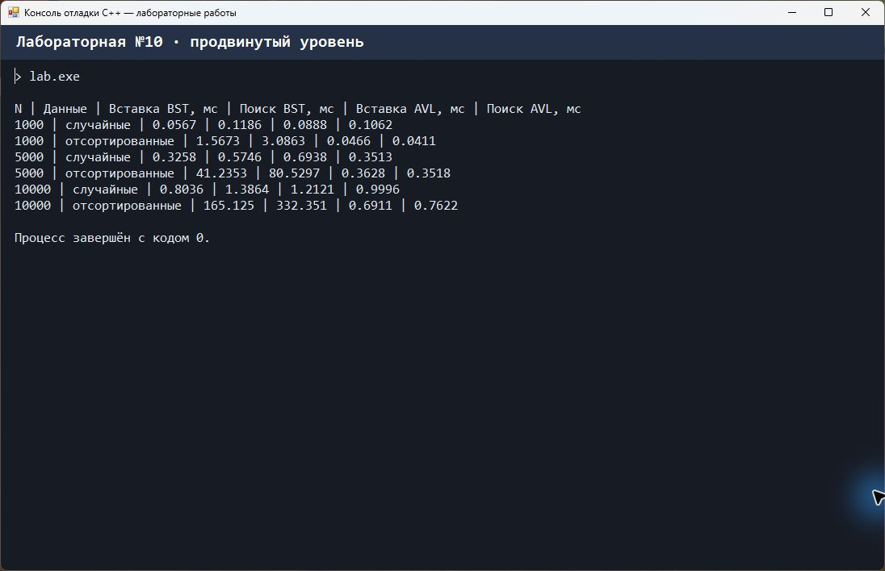

# Лабораторная работа №10 — продвинутый уровень

**Вариант 2**

## Постановка задачи

1. Сравнить время вставки и поиска в обычном BST и AVL-дереве для 1000, 5000 и 10 000 ключей.
2. Повторить измерения для перемешанных и отсортированных ключей. Вывести таблицу результатов.

## Сборка и запуск

В Developer PowerShell для Visual Studio

```powershell
cl /nologo /std:c++17 /EHsc /utf-8 /O2 main.cpp TreeComparison.cpp /Fe:lab.exe
.\lab.exe
```

С g++

```bash
g++ -std=c++17 -O2 -Wall -Wextra -pedantic main.cpp TreeComparison.cpp -o lab
./lab
```

## Исходный код

[TreeComparison.h](TreeComparison.h), [TreeComparison.cpp](TreeComparison.cpp), [main.cpp](main.cpp)

## Результат работы



| N | Данные | Вставка BST, мс | Поиск BST, мс | Вставка AVL, мс | Поиск AVL, мс |
| --- | --- | --- | --- | --- | --- |
| 1000 | случайные | 0.0567 | 0.1186 | 0.0888 | 0.1062 |
| 1000 | отсортированные | 1.5673 | 3.0863 | 0.0466 | 0.0411 |
| 5000 | случайные | 0.3258 | 0.5746 | 0.6938 | 0.3513 |
| 5000 | отсортированные | 41.2353 | 80.5297 | 0.3628 | 0.3518 |
| 10000 | случайные | 0.8036 | 1.3864 | 1.2121 | 0.9996 |
| 10000 | отсортированные | 165.125 | 332.351 | 0.6911 | 0.7622 |

## Контрольные вопросы и ответы

### AVL-дерево

**2. Что такое AVL-дерево? В чём его отличие от обычного BST?**  
AVL ограничивает разность высот поддеревьев каждого узла значениями от −1 до 1. BST само такого условия не поддерживает.

**3. Что такое фактор баланса? Как он вычисляется?**  
Фактор баланса равен высоте левого поддерева минус высота правого.

**4. Какие существуют типы поворотов в AVL-дереве?**  
Есть одиночные правый и левый повороты и двойные левый-правый и правый-левый.

**5. Когда применяется правый поворот? Левый поворот?**  
Правый применяется при перевесе левой ветви без внутреннего изгиба. Левый симметричен.

**6. Когда применяется левый-правый поворот? Правый-левый?**  
Левый-правый исправляет перевес слева с правым изгибом, правый-левый — перевес справа с левым изгибом.

**7. Какова сложность операций в AVL-дереве?**  
Вставка, поиск и удаление O(log n), один поворот O(1).

**8. Почему AVL-дерево называется самобалансирующимся?**  
Структура проверяет высоты и поворачивает поддеревья внутри операций изменения.

**9. Как часто происходит балансировка при вставке?**  
Высота проверяется по пути к корню. Вставка требует не более одной одиночной или двойной перестройки.

**10. Чем AVL-дерево отличается от красно-чёрного дерева?**  
AVL строже ограничивает высоту. Красно-чёрное дерево хранит цвета и допускает больший разброс высот.

**11. В каких случаях AVL-дерево эффективнее BST?**  
AVL особенно полезно, когда порядок входа может выродить BST или нужно гарантировать логарифмический поиск.

### Префиксное дерево (Trie)

**13. Что такое Trie (префиксное дерево)? Для решения каких задач оно используется?**  
В Trie каждый шаг соответствует символу ключа. Оно полезно для словарей, префиксного поиска и автодополнения.

**14. Какова сложность поиска в Trie? От чего она зависит?**  
Поиск проходит L переходов. Переход занимает O(log σ) с map, O(1) с массивом при фиксированном алфавите.

**15. Какая структура данных эффективнее для строк: Trie или хеш-таблица?**  
Хеш-таблица удобна для точного поиска. Trie позволяет идти по префиксу и перечислять его продолжения.

**16. Как реализовать автодополнение с помощью Trie?**  
Дойти до узла префикса и собрать слова из его поддерева, например обходом DFS.

**17. Каковы недостатки Trie? Какой объём памяти он требует?**  
Узлы и связи дают накладные расходы. Число узлов ограничено суммой длин слов плюс один.

[Общий отчёт лабораторной](../README.md)
