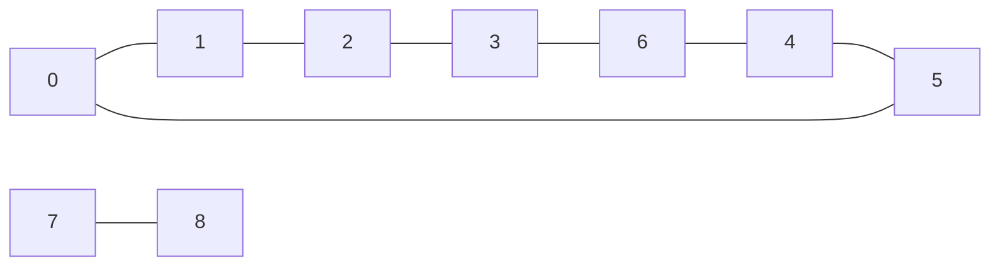
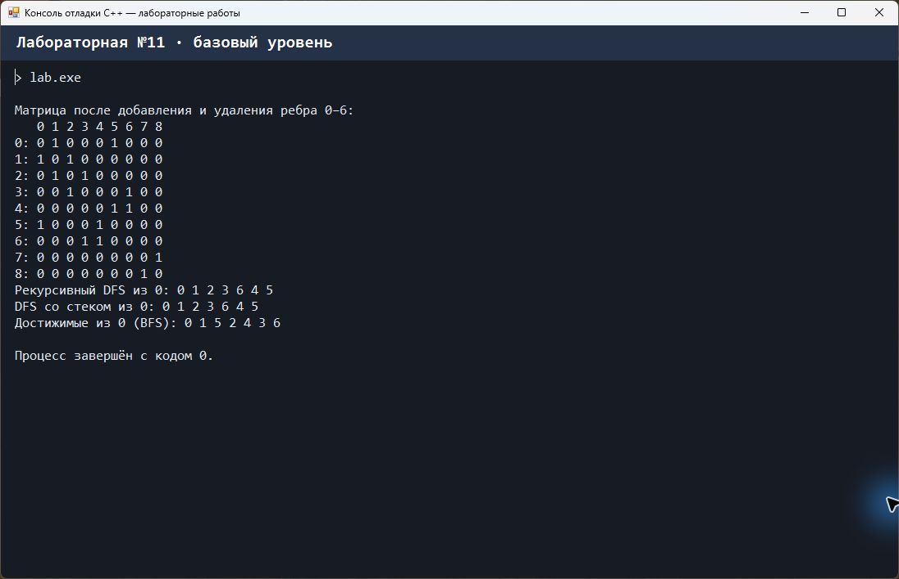

# Лабораторная работа №11 — базовый уровень

**Вариант 2**

## Постановка задачи

1. Представить неориентированный невзвешенный граф матрицей смежности. Показать добавление и удаление ребра.
2. Реализовать рекурсивный и итеративный DFS, а также BFS. Вывести все вершины, достижимые из выбранного старта.

## Сборка и запуск

В Developer PowerShell для Visual Studio

```powershell
cl /nologo /std:c++17 /EHsc /utf-8 /O2 main.cpp Graph.cpp /Fe:lab.exe
.\lab.exe
```

С g++

```bash
g++ -std=c++17 -O2 -Wall -Wextra -pedantic main.cpp Graph.cpp -o lab
./lab
```

## Исходный код

[Graph.h](Graph.h), [Graph.cpp](Graph.cpp), [main.cpp](main.cpp)

## Схема примера



## Результат работы



## Контрольные вопросы и ответы

**1. Что такое граф? Из каких элементов он состоит?**  
Граф состоит из вершин и рёбер между ними.

**2. Чем отличается ориентированный граф от неориентированного?**  
В ориентированном графе ребро имеет направление. В неориентированном оно связывает пару симметрично.

**3. Что такое матрица смежности? Каковы её достоинства и недостатки?**  
Матрица отмечает ребро в клетке пары вершин. Проверка быстрая, память квадратичная.

**4. Что такое список смежности? Каковы его достоинства и недостатки?**  
Список хранит соседей каждой вершины. Он экономит память на разреженных графах.

**5. В каких случаях лучше использовать матрицу смежности, а в каких - список смежности?**  
Матрица удобна на плотных графах и для частых проверок рёбер. Список подходит для редких рёбер и частого обхода соседей.

**6. Какова сложность проверки наличия ребра в матрице смежности? В списке смежности?**  
В матрице проверка O(1), в обычном списке O(deg(v)).

**7. Какова сложность перебора всех соседей вершины в матрице смежности? В списке смежности?**  
По матрице перебирается строка за O(V), по списку только соседи за O(deg(v)).

**8. Что такое поиск в глубину (DFS)? Как он работает?**  
DFS идёт вглубь по непосещённым соседям и возвращается при исчерпании ветви.

**9. Какие задачи решаются с помощью DFS?**  
DFS ищет связность, циклы, топологический порядок и другие свойства графа.

**10. Что такое поиск в ширину (BFS)? Как он работает?**  
BFS через очередь сначала посещает вершины в одном ребре от старта, затем в двух и далее.

**11. Какие задачи решаются с помощью BFS?**  
BFS находит достижимые вершины, расстояния и кратчайшие пути по числу рёбер.

**12. В чём отличие рекурсивной реализации DFS от итеративной?**  
Рекурсивный DFS хранит действия в стеке вызовов, итеративный — в явно созданном стеке.

**13. Почему BFS находит кратчайший путь в невзвешенном графе, а DFS - нет?**  
BFS посещает вершины в порядке неубывания расстояния, поэтому первое посещение даёт короткий путь.

**14. Как найти компоненты связности графа с помощью DFS?**  
Запускать DFS из каждой ещё не посещённой вершины. Один запуск выделяет одну компоненту.

**15. Как проверить наличие цикла в графе с помощью DFS?**  
В неориентированном графе встреча отмеченного соседа, который не является родителем, обнаруживает цикл. В ориентированном ищут ребро к узлу, который ещё в стеке обхода.

[Общий отчёт лабораторной](../README.md)
