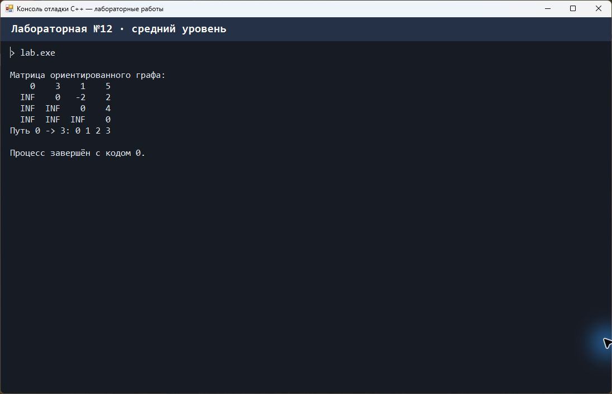

# Лабораторная работа №12 — средний уровень

**Вариант 2**

## Постановка задачи

1. Реализовать алгоритм Флойда–Уоршелла для ориентированного графа.
2. Вывести матрицу кратчайших расстояний между всеми парами вершин и показать восстановленный маршрут для одной пары.

## Сборка и запуск

В Developer PowerShell для Visual Studio

```powershell
cl /nologo /std:c++17 /EHsc /utf-8 /O2 main.cpp FloydWarshall.cpp /Fe:lab.exe
.\lab.exe
```

С g++

```bash
g++ -std=c++17 -O2 -Wall -Wextra -pedantic main.cpp FloydWarshall.cpp -o lab
./lab
```

## Исходный код

[FloydWarshall.h](FloydWarshall.h), [FloydWarshall.cpp](FloydWarshall.cpp), [main.cpp](main.cpp)

## Результат работы



## Контрольные вопросы и ответы

**1. Какие условия должны выполняться для корректной работы алгоритма Дейкстры?**  
Дейкстра требует неотрицательных весов рёбер, достижимых из старта.

**2. Почему алгоритм Дейкстры не работает с отрицательными весами?**  
Отрицательное ребро может улучшить уже выбранное как окончательное расстояние.

**3. Какова временная сложность алгоритма Дейкстры с приоритетной очередью?**  
С двоичной кучей и списками смежности для простого графа O((V+E) log V).

**4. В чём заключается идея алгоритма Флойда-Уоршелла?**  
Для пары i, j сравниваем текущую оценку с маршрутом i → k → j для каждого нового посредника k.

**5. Какова временная сложность алгоритма Флойда-Уоршелла?**  
Время O(V³).

**6. Как алгоритм Флойда-Уоршелла обнаруживает отрицательные циклы?**  
Отрицательный цикл даёт отрицательное значение на диагонали матрицы.

**7. В каких случаях предпочтительнее использовать алгоритм Дейкстры?**  
Дейкстра удобна при неотрицательных весах и малом числе стартовых вершин.

**8. В каких случаях предпочтительнее использовать алгоритм Флойда-Уоршелла?**  
Флойд–Уоршелл подходит для всех пар на относительно небольших графах и принимает отрицательные веса без отрицательных циклов.

**9. Как восстановить кратчайший путь после выполнения алгоритма Дейкстры?**  
Записать предка при улучшении расстояния, пройти по предкам от цели к старту и развернуть результат.

**10. Как восстановить кратчайший путь после выполнения алгоритма Флойда-Уоршелла?**  
Хранить next[i][j] и повторять переход из текущей вершины к следующей на пути до j.

**11. Что такое релаксация в контексте алгоритмов поиска кратчайших путей?**  
Релаксация — замена оценки расстояния более коротким найденным путём.

**12. Как можно оптимизировать алгоритм Дейкстры для разреженных графов?**  
Использовать список смежности и min-heap, обрабатывать только существующие рёбра и пропускать устаревшие записи.

**13. Какую память требует алгоритм Флойда-Уоршелла?**  
Дистанции и матрица следующего шага требуют O(V²).

**14. При каком количестве вершин алгоритм Флойда-Уоршелла становится неприменимым?**  
Предел зависит от времени и памяти. При тысячах вершин кубическое число шагов уже становится существенным.

**15. Как модифицировать алгоритм Дейкстры для нахождения второго кратчайшего пути?**  
Для второго строго большего расстояния при неотрицательных весах можно хранить две лучшие разные оценки на вершину. Для второго простого пути нужен отдельный алгоритм, например Йена.

[Общий отчёт лабораторной](../README.md)
