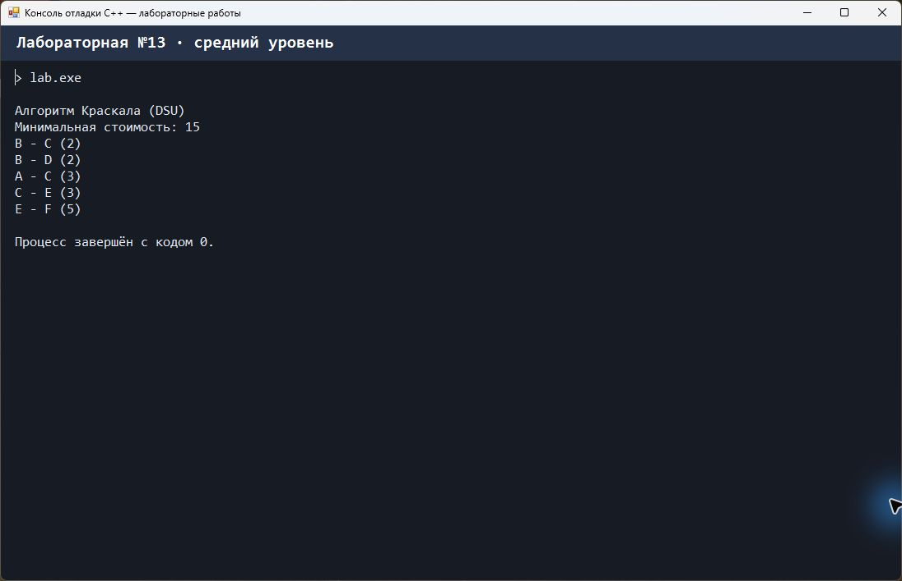

# Лабораторная работа №13 — средний уровень

**Вариант 2**

## Постановка задачи

1. Реализовать алгоритм Краскала с DSU. Отбирать дороги по возрастанию стоимости и не включать ребро, если его концы уже связаны.
2. Вывести рёбра в порядке выбора и итоговую стоимость.

## Сборка и запуск

В Developer PowerShell для Visual Studio

```powershell
cl /nologo /std:c++17 /EHsc /utf-8 /O2 main.cpp Kruskal.cpp /Fe:lab.exe
.\lab.exe
```

С g++

```bash
g++ -std=c++17 -O2 -Wall -Wextra -pedantic main.cpp Kruskal.cpp -o lab
./lab
```

## Исходный код

[Kruskal.h](Kruskal.h), [Kruskal.cpp](Kruskal.cpp), [main.cpp](main.cpp)

## Результат работы



## Контрольные вопросы и ответы

**1. Что такое минимальное остовное дерево (MST)?**  
MST — остов связного взвешенного графа с минимальной суммой весов.

**2. Какие свойства имеет минимальное остовное дерево?**  
Остов содержит все вершины, V−1 ребро и не содержит циклов. Деревьев с одинаковой минимальной ценой может быть несколько.

**3. В чём заключается идея алгоритма Прима?**  
Прим выбирает самое лёгкое ребро от уже взятых вершин к ещё не взятым.

**4. Какова временная сложность алгоритма Прима на матрице смежности?**  
На матрице смежности версия с прямым перебором занимает O(V²).

**5. Какова временная сложность алгоритма Прима с приоритетной очередью?**  
Прим с кучей занимает O((V+E) log V) для простого графа.

**6. В чём заключается идея алгоритма Краскала?**  
Краскал перебирает рёбра по возрастанию веса и берёт те, которые соединяют разные компоненты.

**7. Что такое DSU и как она используется в алгоритме Краскала?**  
DSU поддерживает find и union для компонент. Равный корень означает, что добавление ребра создаст цикл.

**8. Какова временная сложность алгоритма Краскала?**  
Сортировка рёбер O(E log E). Сжатие пути и ранги делают операции DSU почти постоянными амортизированно.

**9. В каких случаях алгоритм Прима эффективнее алгоритма Краскала?**  
Для плотного графа с матрицей версия Прима O(V²) часто удобна. Для списка смежности помогает куча.

**10. В каких случаях алгоритм Краскала эффективнее алгоритма Прима?**  
Краскал удобен на разреженных графах и когда рёбра уже представлены списком или отсортированы.

**11. Как проверить, что построенное дерево является минимальным?**  
Проверить, что это остов, и что ни одно невыбранное ребро не дешевле максимального ребра на соответствующем пути в дереве.

**12. Что произойдёт, если граф не связный?**  
Получится минимальный остовный лес, по дереву на каждую компоненту.

**13. Как модифицировать алгоритмы для поиска максимального остовного дерева?**  
В алгоритме Прима выбирать самое тяжёлое ребро, ведущее в новую вершину. В алгоритме Краскала сортировать рёбра по убыванию веса и по-прежнему пропускать циклы.

**14. Где применяются MST в реальной жизни?**  
Примеры — проектирование линий связи, дорог и инженерных сетей при модели суммарной стоимости.

**15. Как найти второй по минимальности вес MST?**  
Для каждого ребра вне остова рассмотреть допустимые замены рёбер на порождённом цикле и выбрать наименьшую стоимость выше минимальной, если требуется строго второй вес.

[Общий отчёт лабораторной](../README.md)
