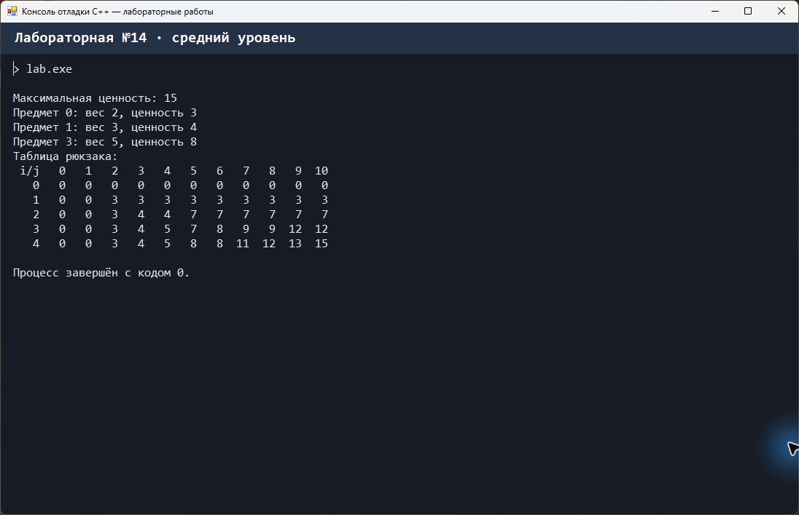

# Лабораторная работа №14 — средний уровень

**Вариант 2**

## Постановка задачи

1. По таблице рюкзака восстановить один оптимальный набор предметов.
2. Вывести общую ценность, индексы, веса и ценности выбранных предметов.

## Сборка и запуск

В Developer PowerShell для Visual Studio

```powershell
cl /nologo /std:c++17 /EHsc /utf-8 /O2 main.cpp Knapsack.cpp /Fe:lab.exe
.\lab.exe
```

С g++

```bash
g++ -std=c++17 -O2 -Wall -Wextra -pedantic main.cpp Knapsack.cpp -o lab
./lab
```

## Исходный код

[Knapsack.h](Knapsack.h), [Knapsack.cpp](Knapsack.cpp), [main.cpp](main.cpp)

## Результат работы



## Контрольные вопросы и ответы

**1. Что такое динамическое программирование? Какие принципы лежат в его основе?**  
ДП сохраняет решения повторяющихся подзадач и собирает из них оптимальный ответ.

**2. В чём разница между рекурсивным подходом с мемоизацией (top-down) и табличным (bottom-up)?**  
Мемоизация вычисляет только запрошенные состояния рекурсивно, таблица заполняет состояния в порядке зависимостей.

**3. Как формулируется задача о рюкзаке (0/1)?**  
Каждый предмет можно взять ноль или один раз. Суммарный вес ограничен, ценность максимизируется.

**4. Какова временная сложность решения задачи о рюкзаке методом ДП?**  
Время O(nW), это псевдополиномиальная оценка по числу W.

**5. Почему для оптимизации памяти нужно проходить по весам в обратном порядке?**  
Проход справа налево читает прежнее состояние меньшего веса и не использует предмет дважды в одном проходе.

**6. Как восстановить выбранные предметы после заполнения таблицы ДП?**  
Идти от последней строки вверх. Если значение улучшилось относительно предыдущей строки, взять предмет и вычесть его вес.

**7. Как формулируется задача LCS?**  
LCS — максимальная по длине последовательность, встречающаяся в обеих строках с сохранением порядка.

**8. Какова временная сложность алгоритма LCS?**  
Двумерный табличный алгоритм требует O(mn) времени.

**9. В чём разница между подпоследовательностью и подстрокой?**  
Подпоследовательность допускает пропуски, подстрока состоит из соседних символов.

**10. Как восстановить LCS после заполнения таблицы?**  
От последней клетки идти по диагонали для равных символов или по большей соседней оценке. Собранные символы развернуть.

**11. Какие ещё задачи решаются с помощью ДП?**  
Примеры — расстояние редактирования, размен монет и кратчайшие пути алгоритмом Флойда–Уоршелла.

**12. В чём отличие задачи о рюкзаке от задачи о рюкзаке с повторениями?**  
В 0/1 каждый предмет доступен один раз, в задаче с повторениями экземпляров может быть сколько угодно.

**13. Можно ли решить LCS за меньшее время, чем O(m×n)?**  
Практически быстрее бывают битовые методы для подходящего алфавита и алгоритмы для малого числа совпадающих пар. Обычная таблица даёт O(mn).

**14. Как адаптировать ДП для LCS трёх строк?**  
Добавить третью координату префикса. При общем последнем символе взять общую диагональ, иначе максимум по трём переходам.

**15. Как модифицировать задачу о рюкзаке для случая, когда предмет можно взять несколько раз?**  
При положительных весах для неограниченного повторения обходить веса по возрастанию в одномерном ДП.

[Общий отчёт лабораторной](../README.md)
