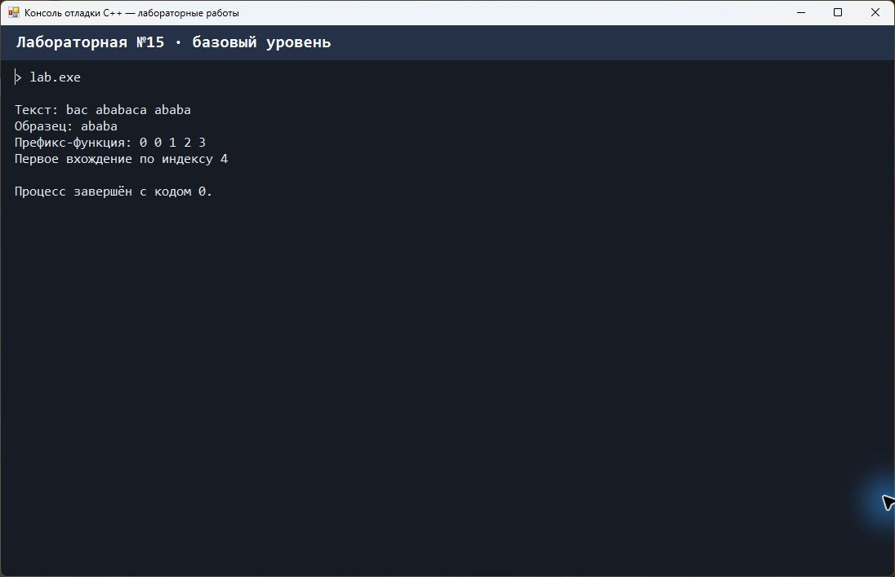

# Лабораторная работа №15 — базовый уровень

**Вариант 2**

## Постановка задачи

1. Вычислить префикс-функцию образца. Вывести её значения и начальную позицию первого вхождения в текст.

## Сборка и запуск

В Developer PowerShell для Visual Studio

```powershell
cl /nologo /std:c++17 /EHsc /utf-8 /O2 main.cpp Kmp.cpp /Fe:lab.exe
.\lab.exe
```

С g++

```bash
g++ -std=c++17 -O2 -Wall -Wextra -pedantic main.cpp Kmp.cpp -o lab
./lab
```

## Исходный код

[Kmp.h](Kmp.h), [Kmp.cpp](Kmp.cpp), [main.cpp](main.cpp)

## Результат работы



## Контрольные вопросы и ответы

**1. В чём заключается идея алгоритма Кнута-Морриса-Пратта?**  
КМП переиспользует известный совпавший префикс, благодаря чему не возвращается по тексту назад.

**2. Что такое префикс-функция и как она вычисляется?**  
Префикс-функция хранит длину максимального собственного префикса, равного суффиксу текущего префикса строки.

**3. Какова временная сложность алгоритма КМП? Почему?**  
Время O(n+m), так как при движении вперёд длина совпадения растёт не больше чем на один, а откаты её уменьшают.

**4. Как работает восстановление по префикс-функции при несовпадении?**  
При несовпадении длина j заменяется на pi[j−1], пока переход не станет возможен или j не обнулится.

**5. В чём преимущество КМП перед наивным алгоритмом?**  
КМП гарантирует линейный обход, тогда как наивный алгоритм может повторить много сравнений и достичь O(nm).

**6. Какие контейнеры STL вы знаете? Какой контейнер когда лучше использовать?**  
vector удобен для индексации, deque для работы с обоими концами, set для упорядоченных ключей, unordered_map для доступа по хешу.

**7. В чём разница между vector и list?**  
vector хранит элементы непрерывно и даёт прямой доступ. list хранит связанные узлы и быстро вставляет по готовому итератору.

**8. В чём разница между set и unordered_set?**  
set хранит порядок и даёт O(log n) для поиска, unordered_set использует хеширование и ожидаемо даёт O(1).

**9. В чём разница между map и unordered_map?**  
map и unordered_map хранят пары ключ–значение. В map ключи упорядочены, в unordered_map используется хеш.

**10. Как работают итераторы в STL?**  
Итератор указывает на текущую позицию. Операции разыменования и продвижения зависят от его категории.

**11. Какие алгоритмы STL вы знаете? Приведите примеры.**  
Например, sort сортирует, find ищет, count_if считает, transform преобразует, unique уплотняет соседние повторы.

**12. Что такое лямбда-выражения в C++? Как они применяются с алгоритмами STL?**  
Лямбда — безымянная функция. Она может передавать алгоритму условие или способ сравнения.

**13. Как удалить элементы из контейнера во время итерации?**  
Использовать возвращённый erase итератор и учитывать правила инвалидирования для конкретного контейнера.

**14. Что такое идиома erase-remove?**  
remove сдвигает сохраняемые элементы к началу и возвращает новую логическую границу. erase удаляет оставшийся хвост.

**15. Как можно изменить порядок обхода контейнера?**  
Можно взять rbegin/rend для обратного обхода или упорядочить последовательность подходящей сортировкой.

[Общий отчёт лабораторной](../README.md)
