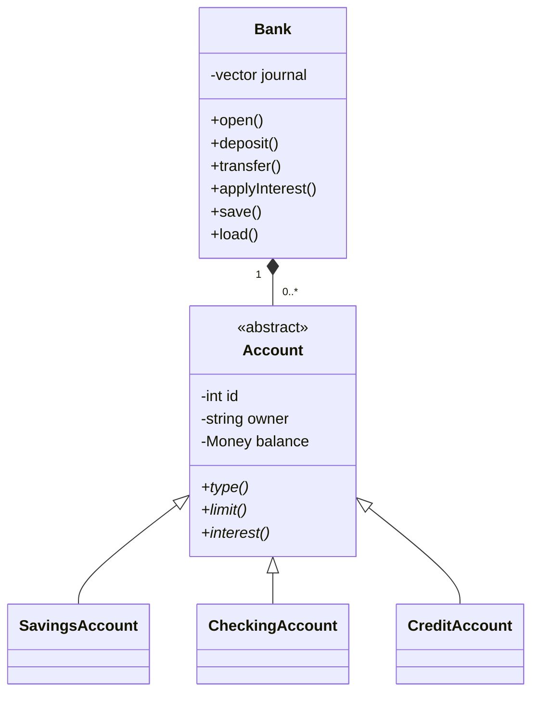
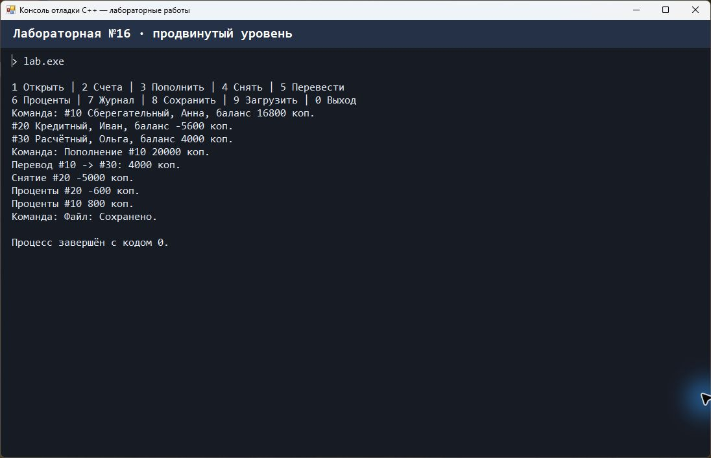
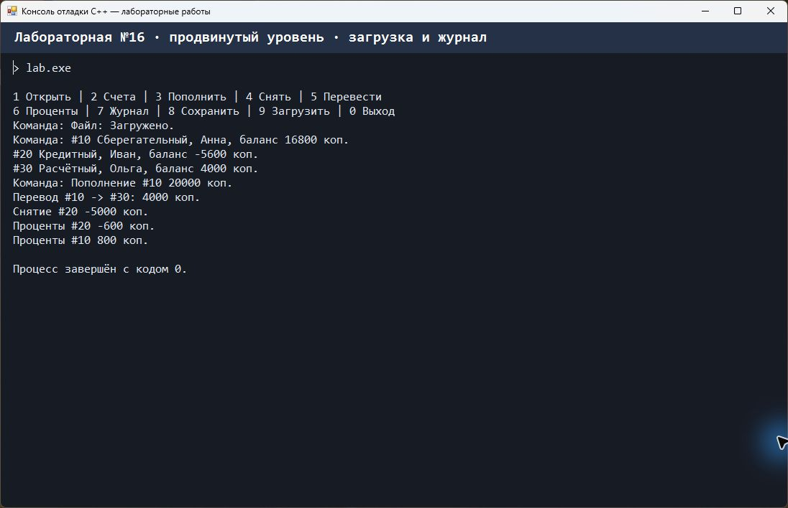

# Лабораторная работа №16 — продвинутый уровень

**Вариант 2**

## Постановка задачи

1. Создать консольную систему управления сберегательными, расчётными и кредитными счетами.
2. Реализовать открытие счёта, пополнение, снятие, перевод, начисление процентов и просмотр журнала.
3. Сохранить и загрузить счета и журнал из текстового файла. Проверить восстановление данных.

## Сборка и запуск

В Developer PowerShell для Visual Studio

```powershell
cl /nologo /std:c++17 /EHsc /utf-8 /O2 main.cpp Bank.cpp /Fe:lab.exe
.\lab.exe
```

С g++

```bash
g++ -std=c++17 -O2 -Wall -Wextra -pedantic main.cpp Bank.cpp -o lab
./lab
```

Сумму операции вводите в целых копейках. Пункты 8 и 9 сохраняют и загружают счета и журнал.

## Исходный код

[Bank.h](Bank.h), [Bank.cpp](Bank.cpp), [main.cpp](main.cpp)

## Диаграмма классов UML



## Результат работы





## Контрольные вопросы и ответы

**1. Что такое наследование? Какие виды наследования есть в C++?**  
Наследование расширяет базовый класс. В C++ есть одиночное и множественное наследование, а также public, protected и private режимы доступа.

**2. Что такое открытое (public) наследование? Какое отношение оно реализует?**  
Public-наследование выражает отношение «является». Производный объект можно использовать через интерфейс базового.

**3. Что такое виртуальный метод? Для чего он нужен?**  
Виртуальный метод можно переопределить, а вызов через базовую ссылку выбирает реализацию по реальному типу.

**4. Что такое чисто виртуальный метод и абстрактный класс?**  
Чисто виртуальный метод объявляется с = 0. Класс с таким методом абстрактен.

**5. Почему деструктор базового класса должен быть виртуальным?**  
Виртуальный деструктор позволяет корректно уничтожить производный объект через указатель базового типа.

**6. Что такое позднее связывание (динамический полиморфизм)?**  
Позднее связывание выбирает вызываемый метод во время выполнения.

**7. Как переопределить метод в производном классе? Что такое override?**  
Нужно объявить совпадающую сигнатуру. override заставляет компилятор проверить соответствие.

**8. Что такое RTTI? Как работает dynamic_cast?**  
RTTI позволяет узнать реальный тип полиморфного объекта. dynamic_cast проверяет такое преобразование во время выполнения.

**9. Как вызвать метод базового класса из производного?**  
Указать квалифицированное имя, например `Employee::print()`.

**10. Что такое диаграмма классов UML? Какие основные элементы?**  
UML-диаграмма показывает классы, поля, операции и связи наследования, владения и зависимости.

**11. Что такое паттерн «Стратегия»? Где он применяется?**  
Стратегия хранит заменяемый алгоритм за общим интерфейсом. Например, можно менять правила расчёта комиссии.

**12. Что такое виртуальный деструктор? Почему он важен?**  
При виртуальном деструкторе сначала вызывается деструктор производного объекта, затем базового.

[Общий отчёт лабораторной](../README.md)
