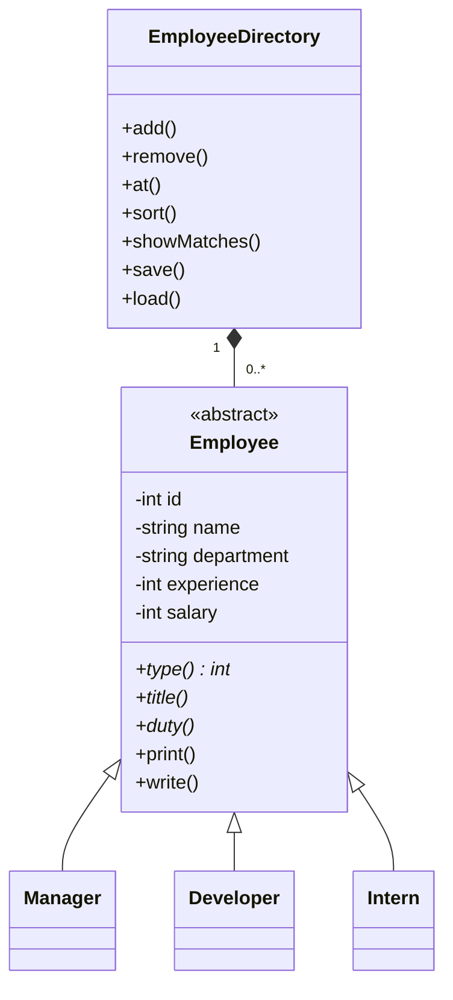

# Лабораторная работа №17 — Мини-проект «Справочник сотрудников»

**Студент** — Ануфриев Владислав Денисович  
**Группа** — ПИЖ-б-о-25-2  
**Вариант** — 2  
**Язык** — C++17

## Цель работы

Объединить наследование, STL, сериализацию и обработку ошибок в одной программе.

## Задание

Реализовать менеджера, разработчика и стажёра. Хранить сотрудников в STL-коллекции, сортировать по зарплате, стажу и имени, искать по имени, отделу и стажу, сохранять и загружать справочник.

## Теория

Employee задаёт общий интерфейс. Справочник владеет объектами через vector и unique_ptr. Фабрика восстанавливает подтип по коду. Текстовый файл хранит версию формата EMPLOYEES1 и поля записей с экранированием кавычек.

## Уровни работы

- [Базовый уровень](базовый/README.md) — сотрудники и stl
- [Средний уровень](средний/README.md) — сохранение, загрузка и исключения
- [Продвинутый уровень](продвинутый/README.md) — мини-проект «справочник сотрудников»

## Диаграмма классов UML

[План защиты на 5–7 минут](продвинутый/Защита.md)

## Обработка исключений

| Ситуация | Исключение | Действие программы |
| --- | --- | --- |
| Текст вместо числа | `invalid_argument` | Повторяет вопрос |
| Число вне диапазона | `out_of_range` | Повторяет вопрос |
| Несуществующий ID или номер строки | `out_of_range` | Показывает сообщение и возвращает в меню |
| Пустая коллекция | `logic_error` | Показывает сообщение и возвращает в меню |
| Файл не открывается или повреждён | `runtime_error` | Оставляет текущие данные |
| Запись не удалась | `runtime_error` | Предлагает другой путь или отмену |

## Сложность

Поиск по ID, фильтр и удаление требуют O(n) обхода вектора. Сортировка обычно O(n log n), при отсутствии дополнительного буфера у stable_sort возможна O(n log² n). Доступ по номеру строки O(1). Сохранение линейно по размеру данных, загрузка дополнительно проверяет уникальность ID.

## Контрольные вопросы и ответы

**1. Что такое сериализация? Для чего она нужна?**  
Сериализация переводит объект в формат для хранения и последующего восстановления.

**2. Какие способы сериализации в C++ вы знаете?**  
Можно записывать поля текстом или в бинарном формате, использовать JSON, XML или специализированную библиотеку.

**3. В чём преимущества и недостатки текстовой сериализации?**  
Текст легко читать и проверять вручную. Обычно он занимает больше места, требует разбора и экранирования.

**4. В чём преимущества и недостатки бинарной сериализации?**  
Двоичный формат может быть компактным и быстрым. Нужно заранее определить представление чисел, версии и совместимость.

**5. Что такое исключение? Для чего нужен механизм исключений?**  
Исключение переносит сведения об ошибке к обработчику и освобождает локальные RAII-ресурсы при выходе из стека.

**6. Какие конструкции используются для работы с исключениями (try, catch, throw)?**  
try задаёт защищённый блок, throw возбуждает исключение, catch его перехватывает.

**7. В чём разница между catch (const std::exception& e) и catch (...)?**  
catch по ссылке std::exception поддерживает what() и производные типы. catch (...) ловит исключения любого типа.

**8. Какие стандартные классы исключений вы знаете?**  
Примеры — invalid_argument, out_of_range, logic_error, runtime_error, bad_alloc.

**9. Как создать собственный класс исключения?**  
Унаследоваться от подходящего класса исключений, например runtime_error, и передать описание через конструктор.

**10. Почему деструкторы не должны выбрасывать исключения?**  
Второе исключение во время раскрутки стека может завершить программу через std::terminate.

**11. Как обрабатывать ошибки ввода данных пользователем с помощью исключений?**  
Разобрать ввод, проверить диапазон и выбросить подходящее исключение. Обработчик показывает ошибку и повторяет запрос.

**12. Как обрабатывать ошибки при работе с файлами с помощью исключений?**  
Проверить состояние потока после открытия и завершения чтения или записи. При ошибке сообщить пользователю и предложить повтор.

**13. Что такое RAII? Как он связан с исключениями?**  
RAII привязывает ресурс ко времени жизни объекта. unique_ptr и файловый поток очищаются автоматически и при исключениях.

**14. Как обрабатывать ошибки выделения памяти (std::bad_alloc)?**  
std::bad_alloc перехватывают по ссылке там, где можно освободить ресурс или корректно сообщить о невозможности продолжить.

**15. В каких ситуациях в вашем проекте используются исключения?**  
Здесь ошибки чисел приводят к повторному вводу, ошибки файлов и коллекции возвращают в меню, ошибка сохранения предлагает другой путь.

## Вывод

Три должности выводят свои обязанности. Проверены все критерии сортировки и поиска, пустая коллекция, неверные числа, отсутствующие записи и файлы, сохранение и повторная загрузка. При ошибке разбора список остаётся доступен.

## Репозиторий

[Репозиторий курса на GitHub](https://github.com/Ko3bIrb/laboratories_C)
