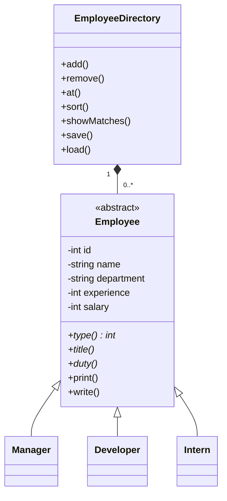
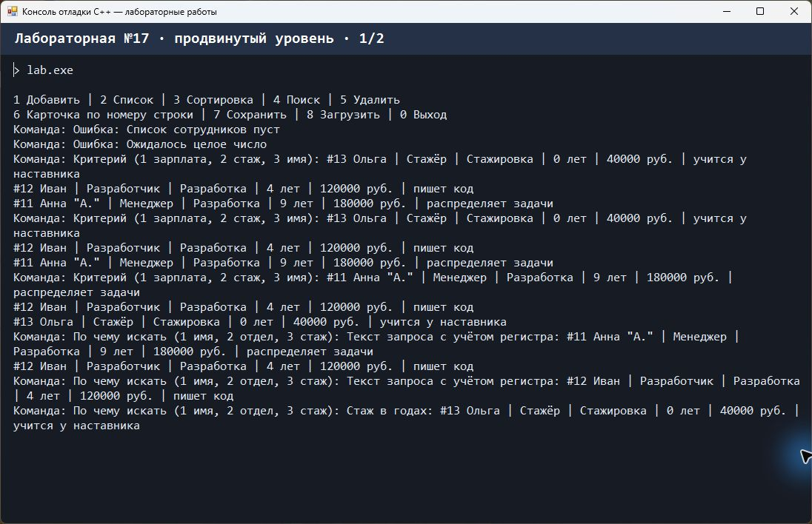
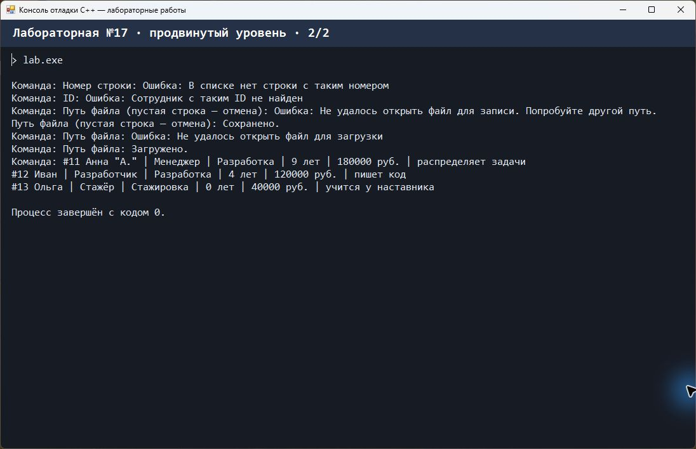

# Лабораторная работа №17 — продвинутый уровень

**Вариант 2**

## Постановка задачи

1. Создать рабочее меню справочника с добавлением, просмотром, удалением и открытием карточек.
2. Реализовать сортировку по зарплате, стажу и имени и поиск по имени, отделу и стажу.
3. Добавить сохранение и загрузку текстового файла. Через исключения обработать неверный ввод, ошибки файлов и доступ к отсутствующим записям.

## Сборка и запуск

В Developer PowerShell для Visual Studio

```powershell
cl /nologo /std:c++17 /EHsc /utf-8 /O2 main.cpp EmployeeDirectory.cpp /Fe:lab.exe
.\lab.exe
```

С g++

```bash
g++ -std=c++17 -O2 -Wall -Wextra -pedantic main.cpp EmployeeDirectory.cpp -o lab
./lab
```

В меню можно добавить сотрудников, отфильтровать и отсортировать список, сохранить его, удалить запись и загрузить сохранённый файл. [Пример для демонстрации](Защита.md).

## Исходный код

[EmployeeDirectory.h](EmployeeDirectory.h), [EmployeeDirectory.cpp](EmployeeDirectory.cpp), [main.cpp](main.cpp)

## Диаграмма классов UML



## Результат работы





## Контрольные вопросы и ответы

**1. Что такое сериализация? Для чего она нужна?**  
Сериализация переводит объект в формат для хранения и последующего восстановления.

**2. Какие способы сериализации в C++ вы знаете?**  
Можно записывать поля текстом или в бинарном формате, использовать JSON, XML или специализированную библиотеку.

**3. В чём преимущества и недостатки текстовой сериализации?**  
Текст легко читать и проверять вручную. Обычно он занимает больше места, требует разбора и экранирования.

**4. В чём преимущества и недостатки бинарной сериализации?**  
Двоичный формат может быть компактным и быстрым. Нужно заранее определить представление чисел, версии и совместимость.

**5. Что такое исключение? Для чего нужен механизм исключений?**  
Исключение переносит сведения об ошибке к обработчику и освобождает локальные RAII-ресурсы при выходе из стека.

**6. Какие конструкции используются для работы с исключениями (try, catch, throw)?**  
try задаёт защищённый блок, throw возбуждает исключение, catch его перехватывает.

**7. В чём разница между catch (const std::exception& e) и catch (...)?**  
catch по ссылке std::exception поддерживает what() и производные типы. catch (...) ловит исключения любого типа.

**8. Какие стандартные классы исключений вы знаете?**  
Примеры — invalid_argument, out_of_range, logic_error, runtime_error, bad_alloc.

**9. Как создать собственный класс исключения?**  
Унаследоваться от подходящего класса исключений, например runtime_error, и передать описание через конструктор.

**10. Почему деструкторы не должны выбрасывать исключения?**  
Второе исключение во время раскрутки стека может завершить программу через std::terminate.

**11. Как обрабатывать ошибки ввода данных пользователем с помощью исключений?**  
Разобрать ввод, проверить диапазон и выбросить подходящее исключение. Обработчик показывает ошибку и повторяет запрос.

**12. Как обрабатывать ошибки при работе с файлами с помощью исключений?**  
Проверить состояние потока после открытия и завершения чтения или записи. При ошибке сообщить пользователю и предложить повтор.

**13. Что такое RAII? Как он связан с исключениями?**  
RAII привязывает ресурс ко времени жизни объекта. unique_ptr и файловый поток очищаются автоматически и при исключениях.

**14. Как обрабатывать ошибки выделения памяти (std::bad_alloc)?**  
std::bad_alloc перехватывают по ссылке там, где можно освободить ресурс или корректно сообщить о невозможности продолжить.

**15. В каких ситуациях в вашем проекте используются исключения?**  
Здесь ошибки чисел приводят к повторному вводу, ошибки файлов и коллекции возвращают в меню, ошибка сохранения предлагает другой путь.

[Общий отчёт лабораторной](../README.md)
