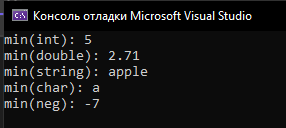
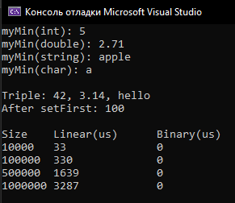

# Лабораторная работа №2: Анализ сложности алгоритмов и шаблоны в C++

**Студент:** Ануфриев Владислав Денисович  
**Группа:** ПИЖ-б-о-25-2  
**Вариант:** 2  
**Уровень:** Средний  
**Технология:** C++17

## Цель работы

Научиться оценивать эффективность алгоритмов с помощью О-нотации (Big O). Освоить классы сложности: O(1), O(log n), O(n), O(n log n), O(n²). Научиться проводить экспериментальный анализ производительности алгоритмов. Освоить создание шаблонов функций и классов для работы с различными типами данных. Получить навыки сравнения производительности различных реализаций одной задачи.

## Структура проекта

- `main.cpp` — единый файл, содержащий реализацию функций анализа сложности, шаблонной функции `myMin`, шаблонного класса `Triple`, алгоритмов поиска (`linearSearch`, `binarySearch`), функции замера времени (`measureTime`) и точку входа `main`.

## Реализация

### 1. Анализ сложности (Базовый уровень)

В коде реализованы функции-примеры, иллюстрирующие различные классы сложности:
- `exampleA` — O(n) (один цикл)
- `exampleB` — O(n²) (два вложенных цикла)
- `exampleC` — O(log n) (счётчик удваивается)
- `exampleD` — O(n log n) (линейный цикл + логарифмический внутри)
- `exampleE` — O(√n) (условие `i * i < n`)

### 2. Шаблонная функция (Вариант 2)

Реализована шаблонная функция `myMin(T a, T b)`, возвращающая минимальное из двух значений. 
*Примечание:* функция названа `myMin`, чтобы избежать конфликта со встроенной `std::min`. Сложность — **O(1)**.

### 3. Шаблонный класс (Вариант 2)

Реализован шаблонный класс `Triple<T1, T2, T3>`, хранящий три значения разных типов. 
**Сложность операций:**
- Конструктор — **O(1)**
- Геттеры (`getFirst`, `getSecond`, `getThird`) — **O(1)**
- Сеттеры (`setFirst`, `setSecond`, `setThird`) — **O(1)**

### 4. Экспериментальное сравнение (Средний уровень)

Реализованы два алгоритма поиска:
- `linearSearch` — линейный поиск, сложность **O(n)**.
- `binarySearch` — бинарный поиск (требует отсортированного массива), сложность **O(log n)**.

С помощью библиотеки `<chrono>` (функция `measureTime`) проведены замеры времени выполнения на массивах размером от 10 000 до 1 000 000 элементов.

## Сборка и запуск

Компиляция и запуск программы осуществляется следующими командами:

g++ -std=c++17 main.cpp -o lab2
./lab2

## Результаты

**Вывод программы (демонстрация шаблонов):**
Скриншот работы программы с выводом `myMin` и `Triple`

**Результаты замеров производительности:**
Эксперимент подтвердил теоретическую сложность. Время линейного поиска O(n) растёт пропорционально размеру массива, в то время как бинарный поиск O(log n) выполняется настолько быстро, что затраченное время меньше разрешающей способности таймера в микросекундах (отображается как 0).

## Используемые технологии

- Язык: C++17
- Компилятор: g++
- Библиотеки: `<iostream>`, `<vector>`, `<chrono>`, `<string>`
- Концепции: О-нотация (Big O), шаблоны функций и классов, лямбда-выражения, замер времени.

## Ответы на контрольные вопросы

**1. Что такое О-нотация (Big O) и зачем она нужна?**
О-нотация — это математическая запись, описывающая верхнюю границу роста времени работы алгоритма при увеличении объёма входных данных. Она нужна для того, чтобы абстрагироваться от характеристик конкретного компьютера и сравнивать алгоритмы по их эффективности. Мы отбрасываем константы и младшие члены (например, 5n + 3 превращается в O(n)) и смотрим только на скорость роста.

**2. Какая сложность у доступа к элементу массива по индексу? Почему?**
Сложность O(1) (константная). Массив в памяти хранится непрерывным блоком. Адрес нужного элемента вычисляется математически по формуле: `базовый_адрес + индекс * размер_элемента`. Компьютеру не нужно перебирать элементы, он сразу обращается по вычисленному адресу.

**3. Какая сложность у бинарного поиска? Почему?**
Сложность O(log n). На каждом шаге алгоритм делит область поиска ровно пополам (отбрасывает половину элементов). Количество шагов равно логарифму по основанию 2 от количества элементов. Например, для массива в 1 000 000 элементов нужно всего около 20 шагов.

**4. Что означает сложность O(n log n)? Приведите пример алгоритма.**
Это означает, что время работы растёт быстрее, чем линейно, но медленнее, чем квадратично. Чаще всего это результат выполнения логарифмического цикла внутри линейного (или наоборот). Примеры: эффективные алгоритмы сортировки (быстрая сортировка, сортировка слиянием), а также наш пример `exampleD`.

**5. Что такое амортизированный анализ? Приведите пример.**
Это метод оценки сложности, при котором учитывается среднее время выполнения операции в серии последовательных вызовов. Пример: операция `push` в динамический массив (например, `std::vector`). Обычно она выполняется за O(1), но когда массив заполнен, происходит расширение (выделение новой памяти и копирование всех элементов), что занимает O(n). Амортизированная сложность всё равно O(1), так как редкие дорогие операции «размазываются» по множеству дешёвых.

**6. Какая сложность у двух вложенных циклов по n итераций каждый?**
O(n²) (квадратичная сложность). Внешний цикл выполняется n раз, и для каждой его итерации внутренний цикл также выполняется n раз. Итого n * n = n² операций.

**7. Какая сложность у рекурсивного вычисления чисел Фибоначчи?**
O(2ⁿ) (экспоненциальная сложность). При вычислении `fib(n)` происходят два рекурсивных вызова: `fib(n-1)` и `fib(n-2)`. Дерево вызовов растёт экспоненциально (каждый вызов порождает ещё два), из-за чего алгоритм крайне неэффективен для больших n.

**8. Что такое шаблоны функций? Как их объявить и использовать?**
Шаблоны функций позволяют писать одну функцию, которая будет работать с разными типами данных. Объявление начинается с ключевого слова `template` и параметра типа: `template <typename T> T myMin(T a, T b) { ... }`. Используется как обычная функция: `myMin(5, 10)` — компилятор сам поймёт, что тип T — это int.

**9. Что такое шаблоны классов? Как их объявить и использовать?**
Шаблоны классов позволяют создавать классы, работающие с разными типами данных. Объявление: `template <typename T> class Stack { T* data; ... };`. При использовании в `main` нужно явно указывать тип в угловых скобках: `Stack<int> s;` или `Stack<std::string> s2;`.

**10. В чём преимущество шаблонов перед перегрузкой функций?**
Шаблоны избавляют от дублирования кода. Вместо того чтобы писать отдельную функцию для `int`, `double` и `string`, вы пишете одну шаблонную. Это сокращает объём кода, снижает вероятность ошибок при копировании и позволяет легко добавлять поддержку новых типов (в том числе пользовательских классов).

**11. Как указать, что шаблонный параметр — тип?**
С помощью ключевого слова `typename` (или `class`). Например: `template <typename T>` или `template <class T>`. В современном C++ предпочтительнее использовать `typename`, так как оно точнее отражает суть.

**12. Можно ли создать шаблон с несколькими параметрами типов?**
Да. В угловых скобках через запятую можно указать несколько параметров. Пример из работы: `template <typename T1, typename T2, typename T3> class Triple { ... };`. Использование: `Triple<int, double, std::string> t;`.

**13. Как провести экспериментальное измерение времени выполнения?**
С помощью библиотеки `<chrono>`. Нужно зафиксировать время до выполнения операции (`auto start = std::chrono::high_resolution_clock::now();`), затем выполнить код, и зафиксировать время после (`auto end = ...now();`). Разница между ними переводится в нужные единицы (микросекунды) с помощью `duration_cast` и выводится на экран.

**14. Почему при измерении времени нужно выполнять операцию многократно?**
Современные процессоры выполняют простые операции за наносекунды, а системные таймеры часто имеют недостаточную точность (или округляют результат). Если замерить очень быструю операцию (например, бинарный поиск) один раз, таймер может показать 0. Многократное выполнение в цикле (например, 1000 раз) увеличивает общее время до измеримых величин, после чего результат делится на количество итераций.

**15. Что важнее: сложность алгоритма или константа?**
Для малых объёмов данных константа может быть важнее (простой алгоритм O(n²) может работать быстрее сложного O(n log n) на массиве из 10 элементов из-за накладных расходов). Однако на больших данных решающее значение имеет именно сложность (асимптотика). Алгоритм с худшей асимптотикой рано или поздно проиграет, какая бы маленькая константа у него ни была. Поэтому при проектировании масштабируемых систем сложность важнее.