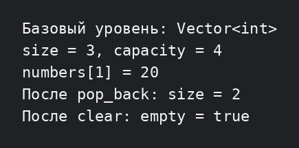

# Лабораторная работа №3 — базовый уровень

Вариант 2: реализован шаблонный динамический массив `Vector<T>` с конструктором по умолчанию и конструктором размера. Показаны обязательные операции `push_back`, `pop_back`, `empty` и `clear`, а также размер, ёмкость и проверяемый доступ по индексу.

## Запуск

```bash
g++ -std=c++17 -Wall -Wextra -pedantic main.cpp -o lab3_basic
./lab3_basic
```


