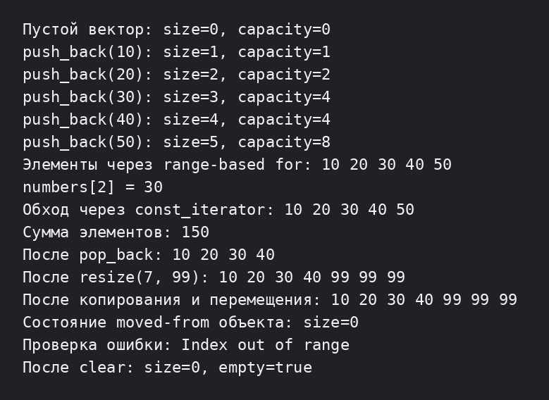

# Лабораторная работа №3: динамический массив и итераторы

**Студент:** Ануфриев Владислав Денисович  
**Группа:** ПИЖ-б-о-25-2  
**Вариант:** 2  
**Уровень:** продвинутый  
**Технология:** C++17

## Цель работы

Реализовать свой шаблонный динамический массив `Vector<T>`, разобраться с выделением памяти и расширением массива, закрепить правило пяти и добавить `const_iterator` для безопасного чтения элементов.

## Постановка задачи

Нужно написать контейнер, похожий на `std::vector`, без использования готового `std::vector` внутри класса. Для варианта 2 продвинутого уровня требуется поддержать правило пяти, итераторы и отдельный `const_iterator`.

## Полное условие продвинутого уровня

Общее задание: реализовать класс `Vector<T>` с поддержкой «правила пяти», итераторами и дополнительной функциональностью согласно выбранному варианту.

В продвинутом уровне предлагаются следующие варианты дополнительной функциональности:

| Вариант | Дополнительная функциональность |
|---:|---|
| 1 | Итераторы с категориями: input, output, forward, bidirectional, random access |
| **2** | **Реализация `const_iterator` (выбранный вариант)** |
| 3 | `reverse_iterator` и методы `rbegin`, `rend` |
| 4 | Операторы сравнения векторов: `==`, `!=`, `<`, `>` |
| 5 | Операторы `+` для конкатенации и `*` для умножения на число |
| 6 | Метод `apply(function)` для применения функции ко всем элементам |
| 7 | Метод `filter(predicate)` для фильтрации элементов |
| 8 | Сериализация: `saveToFile` и `loadFromFile` |
| 9 | Поддержка пользовательских аллокаторов |
| 10 | Метод `partition(pivot)` для разделения на две части |
| 11 | Реализация быстрой сортировки внутри класса |
| 12 | Ленивое копирование (copy-on-write) |
| 13 | Поддержка `std::initializer_list` для удобной инициализации |
| 14 | Реализация `emplace_back` с вариативным шаблоном |
| 15 | Реализация оператора `<<` для вывода вектора |

Для всех вариантов продвинутого уровня также требуются управление динамической памятью, корректное копирование и перемещение объектов, итераторы `begin()`/`end()`, обработка ошибок и отсутствие утечек памяти.

## Структура проекта

- `Vector.h` — шаблонный класс динамического массива;
- `main.cpp` — небольшая демонстрационная программа;
- `screenshots/1.png` — результат запуска программы.

## Реализация

Внутри `Vector<T>` хранятся указатель на массив, текущий размер и ёмкость. При первом `push_back` выделяется одна ячейка, а при заполнении ёмкость увеличивается в два раза. Поэтому большая часть вставок выполняется быстро, а редкие копирования при расширении распределяются по всей серии операций.

Реализованы:

- конструктор по умолчанию, конструкторы размера и заполнения;
- конструктор копирования и копирующее присваивание;
- конструктор перемещения и перемещающее присваивание;
- деструктор с освобождением динамической памяти;
- `push_back`, `pop_back`, `resize`, `reserve`, `clear`;
- `size`, `capacity`, `empty`, `operator[]`;
- `begin`, `end`, `cbegin`, `cend` и тип `const_iterator`;
- проверка выхода за границы и попытки удалить элемент из пустого контейнера.

Копирование сделано глубоким: новый объект получает свой массив. В операторе присваивания есть проверка `this != &other`. Перемещение передаёт указатель, поэтому исходный объект после перемещения становится пустым.

## Сборка и запуск

```bash
cd lab3-C-main/продвинутый
g++ -std=c++17 -Wall -Wextra -pedantic main.cpp -o lab3
./lab3
```

## Результат работы

Программа показывает изменение размера и ёмкости при `push_back`, обход через range-based for и `const_iterator`, копирование и перемещение, изменение размера, обработку ошибки индекса и очистку контейнера.



## Оценка сложности

| Операция | Сложность |
|---|---:|
| `operator[]`, `size`, `capacity`, `empty` | O(1) |
| `push_back` | O(1) амортизированно, O(n) при расширении |
| `pop_back`, `clear` | O(1) |
| `reserve`, расширение массива | O(n) |
| `resize` | O(1) при уменьшении, O(n) при добавлении элементов |
| обход итератором | O(n) для n элементов |
| копирование Vector | O(n) |
| перемещение Vector | O(1) |

При удвоении ёмкости суммарное число копирований за `n` вставок имеет порядок `n`, поэтому средняя стоимость одной вставки равна O(1).

## Вывод

В работе реализован простой аналог динамического массива. На практике проверены управление ёмкостью, глубокое копирование, перемещение и чтение через `const_iterator`. Увеличение ёмкости в два раза показывает, почему `push_back` имеет амортизированную сложность O(1).

## Ответы на контрольные вопросы

1. **Почему массив называется динамическим?** Его размер и выделенная память могут изменяться во время выполнения программы.
2. **Что такое capacity?** `size` показывает число записанных элементов, а `capacity` — сколько элементов можно разместить до следующего расширения.
3. **Почему ёмкость удваивается?** Это уменьшает количество перевыделений памяти и даёт амортизированную сложность `push_back` O(1).
4. **Какова сложность push_back?** Обычно O(1), а при расширении O(n). В серии операций средняя стоимость — O(1).
5. **Что входит в правило трёх?** Деструктор, конструктор копирования и оператор присваивания копированием.
6. **Что добавляет правило пяти?** Конструктор перемещения и оператор присваивания перемещением.
7. **Чем копирование отличается от присваивания?** Конструктор создаёт новый объект, а оператор присваивания заменяет содержимое уже существующего объекта.
8. **Зачем проверять `this != &other`?** Чтобы объект не удалил собственные данные при присваивании самому себе.
9. **Что такое итератор?** Это объект для последовательного доступа к элементам контейнера. В простом векторе роль итератора может выполнять указатель.
10. **Зачем нужны begin и end?** Они задают начало диапазона и позицию сразу после последнего элемента, поэтому контейнер можно использовать в циклах и алгоритмах STL.
11. **Как работает range-based for?** Компилятор вызывает `begin()`, `end()` и последовательно увеличивает итератор до конца диапазона.
12. **Что такое глубокое копирование?** Копируется не только указатель, но и сами элементы в отдельный массив. Объекты не используют одну и ту же память.
13. **Что такое перемещение?** Новый объект забирает указатель на уже выделенный массив, а исходный объект обнуляет свой указатель.
14. **Зачем конструктору перемещения `noexcept`?** Он сообщает, что перемещение не выбрасывает исключения, и позволяет безопаснее использовать его при расширении контейнеров.
15. **Как освобождается память?** В деструкторе вызывается `delete[] data_`. Каждый объект освобождает только принадлежащий ему массив.
