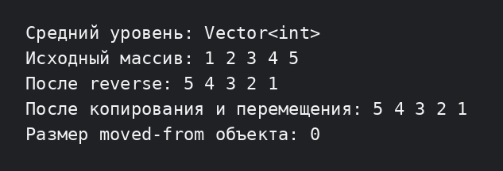

# Лабораторная работа №3 — средний уровень

Вариант 2: к динамическому массиву добавлен метод `reverse()`. Также показаны правило пяти, глубокое копирование и перемещение объекта.

## Запуск

```bash
g++ -std=c++17 -Wall -Wextra -pedantic main.cpp -o lab3_medium
./lab3_medium
```


