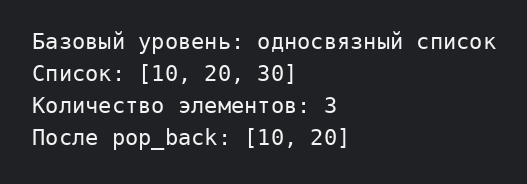

# Лабораторная работа №4 — базовый уровень

Вариант 2: реализован односвязный список с операциями `push_back`, `pop_back` и `print`. Дополнительно выводится количество элементов.

```bash
g++ -std=c++17 -Wall -Wextra -pedantic main.cpp -o lab4_basic
./lab4_basic
```


