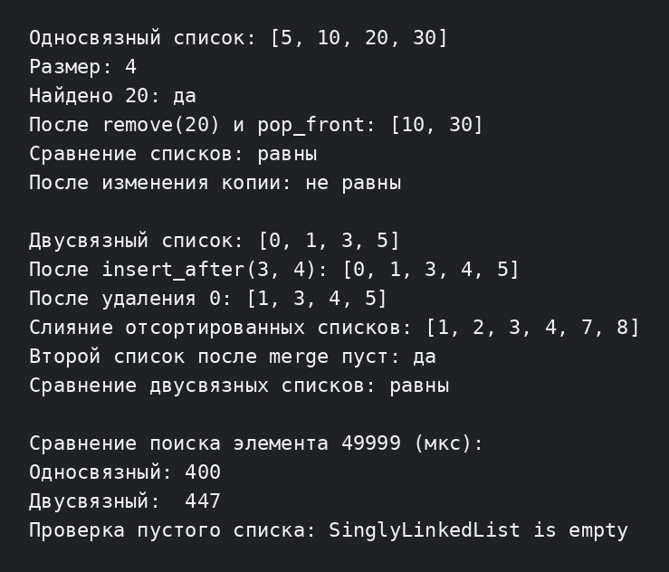

# Лабораторная работа №4: односвязный и двусвязный списки

**Студент:** Ануфриев Владислав Денисович  
**Группа:** ПИЖ-б-о-25-2  
**Вариант:** 2  
**Уровень:** продвинутый  
**Технология:** C++17

## Цель работы

Реализовать шаблонные односвязный и двусвязный списки, научиться вставлять, удалять и находить элементы, сравнить особенности двух структур и правильно освобождать память узлов.

## Полное условие продвинутого уровня

Общее задание: реализовать оба класса `SinglyLinkedList<T>` и `DoublyLinkedList<T>` с полной функциональностью и дополнительными требованиями выбранного варианта.

В продвинутом уровне предлагаются следующие варианты:

| Вариант | Дополнительное требование |
|---:|---|
| 1 | Реализовать итераторы для обоих списков (`begin`, `end`) |
| **2** | **Реализовать операторы сравнения `==` и `!=` для списков (выбранный вариант)** |
| 3 | Реализовать оператор `[]` для доступа по индексу с проверкой границ |
| 4 | Реализовать `sort()` для двусвязного списка |
| 5 | Реализовать `mergeSort()` для односвязного списка |
| 6 | Реализовать сериализацию `saveToFile` и `loadFromFile` |
| 7 | Реализовать исключения для всех операций, включая выход за границы и удаление из пустого списка |
| 8 | Реализовать `std::initializer_list` для удобной инициализации |
| 9 | Реализовать `const_iterator` для обоих списков |
| 10 | Реализовать `reverse_iterator` для двусвязного списка |
| 11 | Сравнить производительность операций односвязного и двусвязного списков |
| 12 | Реализовать кольцевой список на основе двусвязного |
| 13 | Реализовать список с пропусками (skip list) на основе односвязного |
| 14 | Реализовать аллокатор узлов (pool allocator) |
| 15 | Реализовать ленивое удаление с маркировкой удалённых элементов |

Для продвинутого уровня также нужны базовые операции обоих списков: `push_front`, `push_back`, `pop_front`, `pop_back`, поиск, удаление, очистка, проверка размера и пустого состояния. В программе добавлены прямой и обратный обход, простые итераторы и сравнение производительности поиска.

## Реализация

В `SinglyLinkedList<T>` каждый узел хранит данные и указатель `next`. Для быстрого добавления в конец хранится указатель `tail`. В `DoublyLinkedList<T>` узел дополнительно хранит `prev`, поэтому удаление последнего элемента выполняется без поиска предыдущего узла.

В обоих классах реализованы:

- конструкторы копирования и перемещения, операторы присваивания и деструкторы;
- `push_front`, `push_back`, `pop_front`, `pop_back`;
- `find`, `remove`, `clear`, `size`, `empty`;
- простые прямые и константные итераторы;
- операторы сравнения `==` и `!=`;
- освобождение каждого узла в деструкторе.

Для двусвязного списка дополнительно реализованы `insert_after`, `erase` и `merge` двух отсортированных списков по варианту 2 среднего уровня.

## Сборка и запуск

```bash
cd lab4-C-main/продвинутый
g++ -std=c++17 -Wall -Wextra -pedantic main.cpp -o lab4
./lab4
```

## Результат работы

Демонстрационная программа показывает добавление и удаление элементов, поиск, копирование, сравнение списков, вставку после узла, удаление узла, слияние отсортированных списков, измерение поиска и обработку пустого списка.



## Анализ сложности

| Операция | Односвязный список | Двусвязный список |
|---|---:|---:|
| `push_front` | O(1) | O(1) |
| `push_back` с `tail` | O(1) | O(1) |
| `pop_front` | O(1) | O(1) |
| `pop_back` | O(n) | O(1) |
| `find` и `remove` по значению | O(n) | O(n) |
| `insert_after` при известном узле | O(1) | O(1) |
| сравнение `==` | O(n) | O(n) |
| `clear` | O(n) | O(n) |
| доступ по индексу | O(n) | O(n) |

Список не хранит элементы подряд, поэтому прямого доступа по индексу за O(1), как у массива, нет. Цена за удобную вставку узлов — дополнительная память под один или два указателя на каждый элемент.

## Вывод

В работе реализованы два вида связных списков с ручным управлением памятью. На примерах проверены указатели `head` и `tail`, различие удаления с конца, итераторы, сравнение содержимого и слияние отсортированных двусвязных списков.

## Ответы на контрольные вопросы

1. **Чем связный список отличается от динамического массива?** В массиве элементы лежат подряд и доступны по индексу за O(1). В списке узлы могут находиться в разных местах памяти и соединяются указателями, поэтому поиск элемента по позиции занимает O(n).
2. **Какие операции в односвязном списке выполняются за O(1)?** Вставка и удаление из начала, а также вставка в конец при наличии `tail`. Удаление после уже найденного узла тоже может быть O(1).
3. **Почему удаление из конца односвязного списка требует O(n)?** Перед удалением последнего узла нужно найти узел, который стоит перед `tail`, а для этого приходится пройти список от `head`.
4. **Какие преимущества даёт `tail` в односвязном списке?** Он позволяет добавлять новый узел в конец без прохода по всему списку, то есть за O(1).
5. **Чем двусвязный список отличается от односвязного?** У его узла есть два указателя: на следующий и предыдущий узел. Это требует больше памяти, но позволяет двигаться в обе стороны и быстро удалять последний узел.
6. **Какие операции в двусвязном списке выполняются быстрее?** `pop_back` выполняется за O(1), потому что предыдущий узел доступен через `prev`. Обратный обход также выполняется естественно через `prev`.
7. **Что такое head и tail?** `head` указывает на первый узел, а `tail` — на последний. Для пустого списка оба указателя равны `nullptr`.
8. **Как удалить узел из середины односвязного списка?** Нужно найти предыдущий узел, перенаправить его `next` на следующий узел удаляемого элемента и освободить память через `delete`.
9. **Как удалить узел из середины двусвязного списка?** Достаточно связать `node->prev->next` с `node->next`, а `node->next->prev` — с `node->prev`, после чего удалить сам узел.
10. **Что произойдёт, если забыть обновить `tail`?** `tail` будет указывать на удалённую память. Это может привести к обращению к освобождённому объекту, повреждению списка и аварийному завершению.
11. **Как реализовать реверс односвязного списка?** Нужно последовательно менять направление `next`: хранить предыдущий, текущий и следующий узлы, а в конце поменять местами `head` и `tail`.
12. **Как обнаружить цикл в списке?** Можно использовать алгоритм Флойда: медленный указатель движется на один узел, быстрый — на два. Если они встретились, в списке есть цикл.
13. **В каких случаях стоит использовать список вместо массива?** Когда часто вставляются и удаляются элементы, особенно в начале или в середине уже найденной позиции, и не нужен быстрый доступ по индексу.
14. **Какая дополнительная память требуется для каждого узла?** В односвязном списке нужен один указатель `next`, в двусвязном — два указателя `prev` и `next`, кроме памяти под сами данные.
15. **Почему доступ по индексу в списке имеет сложность O(n)?** Чтобы получить элемент с индексом `i`, нужно пройти по ссылкам от `head` до этого элемента. Случайного вычисления адреса, как у массива, нет.
