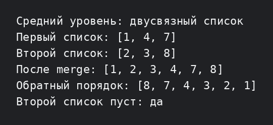

# Лабораторная работа №4 — средний уровень

Вариант 2: реализован двусвязный список с `push_back`, `pop_back`, прямым и обратным выводом, а также слиянием двух отсортированных списков.

```bash
g++ -std=c++17 -Wall -Wextra -pedantic main.cpp -o lab4_medium
./lab4_medium
```


