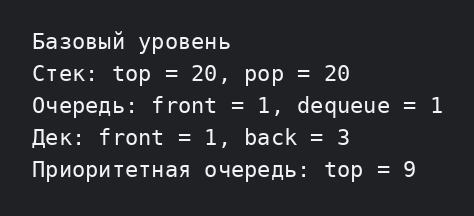

# Лабораторная работа №5 — базовый уровень

Реализованы основные операции четырёх структур: стек, очередь на двух стеках, дек и приоритетная очередь. В демонстрации проверяются `push`/`pop`, `enqueue`/`dequeue`, операции с обоими концами дека и получение вершины max-heap.

```bash
g++ -std=c++17 -Wall -Wextra -pedantic main.cpp -o lab5_basic
./lab5_basic
```


