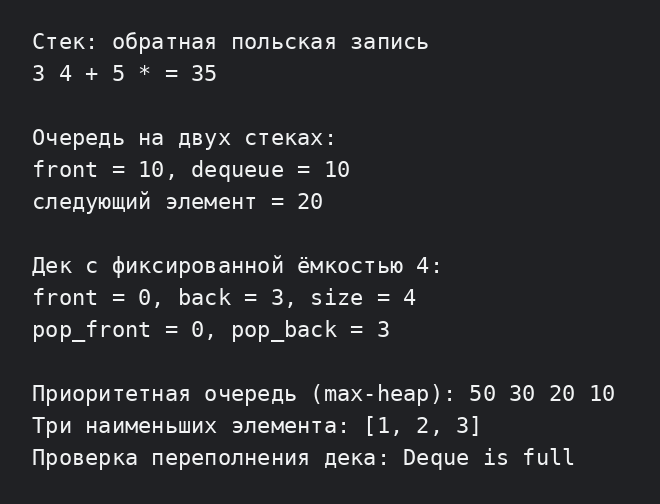

# Лабораторная работа №5: стек, очередь, дек и приоритетная очередь

**Студент:** Ануфриев Владислав Денисович  
**Группа:** ПИЖ-б-о-25-2  
**Вариант:** 2  
**Уровень:** продвинутый  
**Технология:** C++17

## Цель работы

Реализовать четыре основные линейные структуры данных, разобраться с принципами LIFO и FIFO, научиться использовать стек для вычисления выражений и реализовать приоритетную очередь на основе двоичной кучи.

## Постановка задачи для варианта 2

Каждый вариант содержит четыре задания:

1. **Стек:** вычислить значение выражения в обратной польской записи, например `3 4 + 5 *`.
2. **Очередь:** реализовать очередь на двух стеках.
3. **Дек:** реализовать дек с фиксированной ёмкостью на основе кольцевого буфера.
4. **Приоритетная очередь:** найти `K` наименьших элементов в массиве.

## Теоретическая часть

Стек работает по принципу LIFO: последним добавленный элемент удаляется первым. Очередь работает по принципу FIFO: первым удаляется самый старый элемент. Дек разрешает добавление и удаление с обоих концов. В приоритетной очереди первым извлекается элемент с наибольшим приоритетом; в этой работе она построена на max-heap.

## Реализация

В [Structures.h](Structures.h) находятся четыре шаблонных класса:

- `Stack<T>` — динамический массив с операциями `push`, `pop`, `top`, `empty`, `size`;
- `QueueTwoStacks<T>` — очередь, где входящие элементы складываются в один стек, а для удаления при необходимости переносятся во второй;
- `FixedDeque<T>` — дек на массиве фиксированного размера с кольцевой индексацией;
- `PriorityQueue<T>` — max-heap с операциями `push`, `pop`, `top`.

Функция `evaluateRpn` использует стек для вычисления арифметического выражения. Функция `kSmallest` хранит `K` наименьших значений в небольшой max-heap: если новый элемент меньше вершины, вершина заменяется.

## Сборка и запуск

```bash
cd lab5-C-main/продвинутый
g++ -std=c++17 -Wall -Wextra -pedantic main.cpp -o lab5
./lab5
```

## Результат работы

Программа демонстрирует вычисление `3 4 + 5 *`, FIFO-поведение очереди, работу дека с заполнением и удалением с двух концов, выдачу элементов приоритетной очередью и поиск трёх наименьших элементов.



## Оценка сложности

| Операция | Сложность |
|---|---:|
| `Stack::push`, `pop`, `top` | O(1) амортизированно / O(1) |
| перенос элементов между стеками очереди | O(n) за перенос, амортизированно O(1) на операцию |
| `QueueTwoStacks::enqueue`, `dequeue`, `front` | O(1) амортизированно |
| операции дека | O(1) |
| `PriorityQueue::top` | O(1) |
| `PriorityQueue::push`, `pop` | O(log n) |
| поиск K наименьших элементов | O(n log K) |

В деке индексы вычисляются по модулю ёмкости, поэтому элементы не нужно сдвигать при работе с концами. В очереди на двух стеках каждый элемент переносится из входного стека в выходной не более одного раза.

## Вывод

В работе реализованы стек, очередь на двух стеках, кольцевой дек и приоритетная очередь на max-heap. Проверены основные операции, обработка пустых структур и переполнение дека. Стек применён для обратной польской записи, а куча — для поиска K наименьших элементов.

## Ответы на контрольные вопросы

1. **В чём принцип работы стека (LIFO)?** Последним добавленный элемент удаляется первым. Все операции происходят с одной вершиной стека.
2. **В чём принцип работы очереди (FIFO)?** Элемент, который пришёл первым, обслуживается и удаляется первым. Добавление идёт в конец, удаление — из начала.
3. **Чем дек отличается от обычной очереди?** В деке можно добавлять и удалять элементы с обоих концов, а обычная очередь добавляет с одного конца и удаляет с другого.
4. **Что такое приоритетная очередь?** Это структура, которая выдаёт элемент с наибольшим или наименьшим приоритетом, а не обязательно самый старый. Она используется в планировщиках, алгоритме Дейкстры и симуляциях.
5. **Как реализовать стек на динамическом массиве?** Хранить массив и размер, добавлять элемент в `data[size]`, а при заполнении выделять больший массив и копировать элементы.
6. **Как реализовать очередь на кольцевом буфере?** Хранить индексы начала и конца и после каждой операции переходить к следующей позиции по модулю ёмкости. Отдельно хранится текущее количество элементов.
7. **Почему приоритетную очередь обычно реализуют на куче?** Куча сохраняет максимальный или минимальный элемент в корне и позволяет добавлять и удалять его за O(log n), не сортируя весь массив.
8. **Какова сложность push и pop в стеке?** O(1), если массив не расширяется. При расширении `push` занимает O(n), но амортизированно остаётся O(1).
9. **Какова сложность enqueue и dequeue в очереди?** В кольцевом буфере обе операции O(1). В очереди на двух стеках перенос может быть O(n), но амортизированная стоимость одной операции O(1).
10. **Какова сложность операций в приоритетной очереди?** `top` выполняется за O(1), а `push` и `pop` — за O(log n), потому что элемент поднимается или опускается по высоте кучи.
11. **Как проверить скобки стеком?** Открывающие скобки кладутся в стек. Для закрывающей проверяется вершина: она должна быть соответствующей открывающей скобкой. В конце стек должен быть пустым.
12. **Как реализовать очередь на двух стеках?** Новые элементы кладутся во входной стек. Перед удалением, если выходной стек пуст, все элементы переносятся туда, меняя порядок на FIFO.
13. **Как реализовать дек на двусвязном списке?** Узлы хранят `prev` и `next`, а список — `head` и `tail`. Вставка и удаление с любого конца меняют несколько указателей и занимают O(1).
14. **Как реализовать дек на кольцевом буфере?** Выделить массив фиксированной ёмкости, хранить индекс первого элемента и размер, а позиции начала и конца вычислять по модулю ёмкости.
15. **Как реализовать стек с получением минимума за O(1)?** Хранить вместе с каждым элементом минимум на текущем префиксе или использовать второй стек минимумов. При `top` минимум берётся с вершины второго стека.
