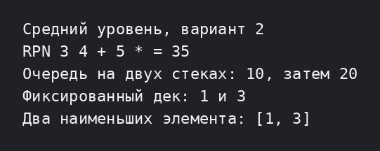

# Лабораторная работа №5 — средний уровень

Для варианта 2 показаны прикладные операции: вычисление обратной польской записи стеком, очередь на двух стеках, дек с фиксированной ёмкостью и поиск двух наименьших элементов через приоритетную очередь.

```bash
g++ -std=c++17 -Wall -Wextra -pedantic main.cpp -o lab5_medium
./lab5_medium
```


