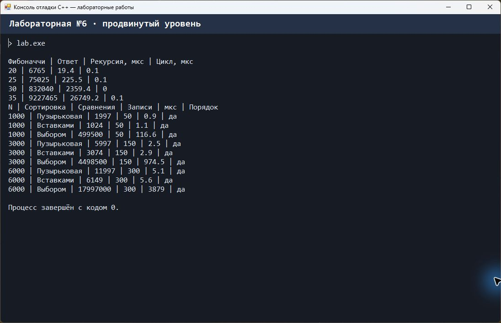

# Лабораторная работа №6 — продвинутый уровень

**Вариант 2**

## Постановка задачи

1. Вычислить одни и те же числа Фибоначчи рекурсивно и циклом. Сверить ответы и сравнить время на нескольких значениях n.
2. Повторить сравнение трёх простых сортировок на почти отсортированных массивах.

## Сборка и запуск

В Developer PowerShell для Visual Studio

```powershell
cl /nologo /std:c++17 /EHsc /utf-8 /O2 main.cpp Comparison.cpp /Fe:lab.exe
.\lab.exe
```

С g++

```bash
g++ -std=c++17 -O2 -Wall -Wextra -pedantic main.cpp Comparison.cpp -o lab
./lab
```

## Исходный код

[Comparison.h](Comparison.h), [Comparison.cpp](Comparison.cpp), [main.cpp](main.cpp)

## Результат работы



## Контрольные вопросы и ответы

**1. Что такое рекурсия? Из каких компонентов состоит рекурсивная функция?**  
Рекурсия вызывает ту же функцию прямо или косвенно. Нужны базовый случай и переход к меньшей задаче.

**2. Что такое базовый случай рекурсии? Почему он важен?**  
Базовый случай выдаёт ответ без нового вызова и останавливает цепочку.

**3. Чем отличается прямая рекурсия от косвенной?**  
При прямой рекурсии функция вызывает себя. При косвенной вызов возвращается к ней через другие функции.

**4. Что такое хвостовая рекурсия? В чём её преимущество?**  
При хвостовой рекурсии рекурсивный вызов является последним действием. Если компилятор заменит его циклом, стек расти не будет.

**5. Какова временная сложность рекурсивного вычисления чисел Фибоначчи? Почему?**  
Наивный Фибоначчи занимает Θ(φⁿ), поскольку один вызов порождает вычисления для n−1 и n−2 и повторяет подзадачи.

**6. Как можно оптимизировать рекурсивное вычисление Фибоначчи?**  
Мемоизация даёт O(n) времени и памяти. В цикле достаточно хранить два предыдущих значения, поэтому дополнительная память O(1).

**7. В чём отличие рекурсивной реализации от итеративной?**  
Рекурсивная версия использует вызовы и стек, а итеративная изменяет переменные в цикле.

**8. Какова сложность пузырьковой сортировки? Когда она становится O(n)?**  
Пузырьковая сортировка занимает O(n²) в худшем случае и O(n) при отсортированном вводе и флаге обмена.

**9. Чем сортировка вставками отличается от сортировки выбором?**  
Вставки перемещают очередной элемент в готовую часть. Выбор каждый раз ищет минимум всей оставшейся части.

**10. Какая из простых сортировок является устойчивой? Что это значит?**  
Пузырёк и вставки устойчивы, если равные элементы не переставляются. Устойчивость означает сохранение порядка элементов с одинаковыми ключами.

**11. Какая из простых сортировок работает лучше на почти отсортированных данных?**  
Вставки обычно хорошо работают на почти отсортированных данных, так как число сдвигов равно числу инверсий.

**12. Как реализовать пузырьковую сортировку с оптимизацией?**  
Хранить флаг обмена и завершать работу после прохода без обменов. Границу прохода можно сокращать.

**13. Что такое рекурсивный поиск с возвратом (backtracking)?**  
Backtracking пробует очередной шаг и откатывает его, если продолжение невозможно.

**14. Как рекурсивно обойти лабиринт?**  
Пометить посещённую клетку и рекурсивно проверить доступных соседей. Для перебора всех путей отмеченную клетку освобождают при возврате.

**15. Какова сложность Ханойских башен? Сколько ходов нужно для перемещения n дисков?**  
Для n дисков требуется 2ⁿ−1 ходов. Время Θ(2ⁿ), глубина стека O(n).

[Общий отчёт лабораторной](../README.md)
