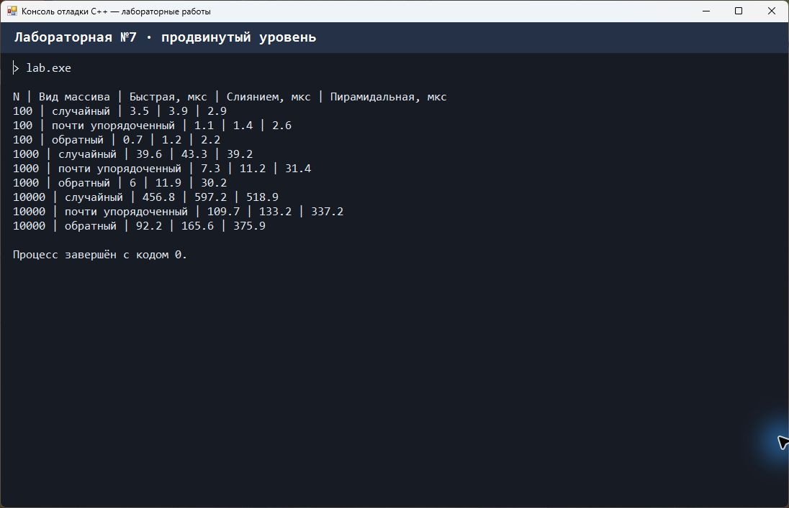

# Лабораторная работа №7 — продвинутый уровень

**Вариант 2**

## Постановка задачи

1. Реализовать быструю сортировку, сортировку слиянием и пирамидальную сортировку. Сравнить их время на случайных, почти отсортированных и обратно отсортированных массивах.
2. Реализовать внешнюю сортировку: читать целые числа из входного файла блоками, сортировать их и попарно сливать промежуточные файлы.
3. Записать отсортированные числа в выходной файл и вывести количество начальных блоков.

## Сборка и запуск

В Developer PowerShell для Visual Studio

```powershell
cl /nologo /std:c++17 /EHsc /utf-8 /O2 main.cpp ExternalSort.cpp /Fe:lab.exe
.\lab.exe
```

С g++

```bash
g++ -std=c++17 -O2 -Wall -Wextra -pedantic main.cpp ExternalSort.cpp -o lab
./lab
```

Для сортировки файла после сборки выполните `.\lab.exe numbers.txt sorted.txt`. Входной файл содержит целые числа через пробел или перевод строки.

## Исходный код

[ExternalSort.h](ExternalSort.h), [ExternalSort.cpp](ExternalSort.cpp), [main.cpp](main.cpp)

## Результат работы




| N | Вид массива | Быстрая, мкс | Слиянием, мкс | Пирамидальная, мкс |
| --- | --- | --- | --- | --- |
| 100 | случайный | 3.5 | 3.9 | 2.9 |
| 100 | почти упорядоченный | 1.1 | 1.4 | 2.6 |
| 100 | обратный | 0.7 | 1.2 | 2.2 |
| 1000 | случайный | 39.6 | 43.3 | 39.2 |
| 1000 | почти упорядоченный | 7.3 | 11.2 | 31.4 |
| 1000 | обратный | 6 | 11.9 | 30.2 |
| 10000 | случайный | 456.8 | 597.2 | 518.9 |
| 10000 | почти упорядоченный | 109.7 | 133.2 | 337.2 |
| 10000 | обратный | 92.2 | 165.6 | 375.9 |

## Контрольные вопросы и ответы

**1. Какова сложность быстрой сортировки в лучшем, среднем и худшем случае?**  
У быстрой сортировки лучший и средний случаи O(n log n), худший O(n²).

**2. Когда возникает худший случай для быстрой сортировки?**  
Худший случай возникает, если разбиение снова и снова оставляет почти все элементы с одной стороны.

**3. Как можно улучшить быструю сортировку для защиты от худшего случая?**  
Помогают случайный опорный элемент, медиана трёх, трёхчастное разбиение и переход к куче при чрезмерной глубине.

**4. Какова сложность сортировки слиянием? Почему она всегда O(n log n)?**  
Обычное слияние тратит O(n) на каждый из O(log n) уровней разбиения.

**5. Какие преимущества и недостатки имеет сортировка слиянием перед быстрой?**  
Слияние устойчиво и даёт предсказуемое время. Массиву нужен буфер O(n). Быстрая сортировка обычно работает в самом массиве.

**6. Как работает пирамидальная сортировка? Какова её сложность?**  
Строится max-heap, затем корень меняется местами с последним элементом и восстанавливается куча. Время O(n log n).

**7. Какая из трёх сортировок устойчивая? Почему?**  
Слияние устойчиво, если при равенстве первым берётся элемент слева.

**8. Какая из трёх сортировок требует дополнительной памяти? Сколько?**  
Слиянию массива нужен буфер O(n). Быстрой сортировке в этой программе нужен стек O(log n). Итеративная пирамидальная занимает O(1) памяти.

**9. Какая из трёх сортировок лучше работает на почти отсортированных данных?**  
Обычное слияние почти не использует упорядоченность. Быстрая с опорой в середине часто работает хорошо, результат зависит от входа. Естественное слияние способно использовать готовые серии.

**10. Зачем в пирамидальной сортировке сначала строится куча?**  
Куча гарантирует максимум в корне, и его легко перенести в конец.

**11. Что такое «разделяй и властвуй»? Как он применяется в быстрой сортировке и сортировке слиянием?**  
Разделяй и властвуй разбивает задачу. В быстрой сортировке перестановки происходят при разбиении, в слиянии — после сортировки частей.

**12. Можно ли реализовать быструю сортировку итеративно (без рекурсии)?**  
Да. Границы ещё не обработанных интервалов можно хранить в явном стеке.

**13. Почему быстрая сортировка обычно быстрее сортировки слиянием на практике?**  
Последовательные обращения внутри разбиения и отсутствие буфера часто снижают расходы на копирование и память.

**14. Когда выгодно использовать пирамидальную сортировку?**  
Пирамидальная полезна, когда нужны гарантированное O(n log n) и постоянная дополнительная память.

**15. Какой алгоритм сортировки вы бы выбрали для встроенных систем с ограниченной памятью?**  
При жёстком лимите памяти подходит итеративная пирамидальная сортировка.

[Общий отчёт лабораторной](../README.md)
