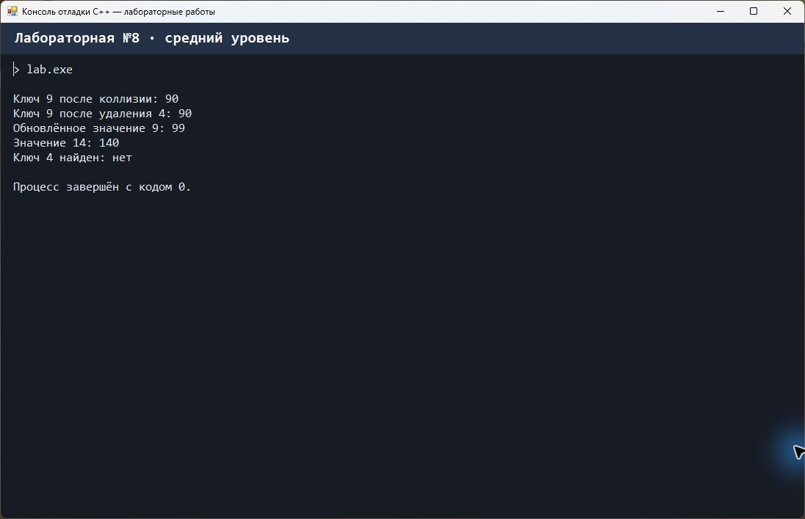

# Лабораторная работа №8 — средний уровень

**Вариант 2**

## Постановка задачи

1. Реализовать хеш-таблицу с ключами и значениями int и разрешением коллизий линейным пробированием.
2. Продемонстрировать вставку, обновление, поиск и удаление. Показать, что после удаления ключа другие элементы в той же цепочке проб остаются доступны.

## Сборка и запуск

В Developer PowerShell для Visual Studio

```powershell
cl /nologo /std:c++17 /EHsc /utf-8 /O2 main.cpp HashTable.cpp /Fe:lab.exe
.\lab.exe
```

С g++

```bash
g++ -std=c++17 -O2 -Wall -Wextra -pedantic main.cpp HashTable.cpp -o lab
./lab
```

## Исходный код

[HashTable.h](HashTable.h), [HashTable.cpp](HashTable.cpp), [main.cpp](main.cpp)

## Результат работы



## Контрольные вопросы и ответы

**1. Какое условие необходимо для применения двоичного поиска?**  
Данные должны быть упорядочены по ключу поиска.

**2. Какова сложность двоичного поиска? Почему она логарифмическая?**  
Время O(log n), поскольку каждый шаг сокращает область примерно вдвое.

**3. В чём разница между итеративной и рекурсивной реализацией двоичного поиска?**  
Итеративная реализация хранит границы в цикле, рекурсивная передаёт их при вызове с меньшим диапазоном.

**4. Чем опасен вариант mid = (left + right) / 2? Как правильно вычислять середину?**  
Сумма границ может переполниться. Формула `left + (right - left) / 2` безопаснее для неотрицательных индексов.

**5. Что такое хеш-таблица? Из каких компонентов она состоит?**  
Хеш-таблица состоит из ячеек, хеш-функции и способа разрешения коллизий.

**6. Какие требования предъявляются к хеш-функции?**  
Хеш-функция должна быть быстрой, воспроизводимой и равномерно распределять ожидаемые ключи.

**7. Что такое коллизия в хеш-таблице? Как с ней бороться?**  
Коллизия означает одинаковую стартовую позицию. Её обрабатывают цепочками или пробированием.

**8. В чём отличие метода цепочек от открытой адресации?**  
При цепочках в ячейке хранится группа записей. При открытой адресации записи лежат в самих ячейках массива.

**9. Что такое первичная и вторичная кластеризация?**  
Первичная кластеризация — рост плотных блоков при линейном пробировании. Вторичная — одинаковая последовательность проб для ключей с одним стартом.

**10. Какова средняя и худшая сложность операций в хеш-таблице?**  
В среднем O(1) при хорошем хеше и умеренной загрузке, в худшем O(n) при длинной цепочке или пробировании порядка размера таблицы.

**11. Когда эффективнее использовать двоичный поиск, а когда - хеш-таблицу?**  
Двоичный поиск подходит для готового отсортированного массива и поиска границ. Хеш-таблица удобна для частого поиска точных ключей.

**12. Что такое коэффициент загрузки хеш-таблицы? Почему он важен?**  
Загрузка — отношение числа занятых ячеек к ёмкости. При заполнении пробирование требует больше шагов.

**13. Как работает рехеширование (динамическое расширение хеш-таблицы)?**  
Создать больший массив и заново вставить живые записи с учётом новой ёмкости.

**14. Как выбрать размер хеш-таблицы? Почему часто выбирают простое число?**  
Ёмкость подбирают по объёму данных и загрузке. Простое число часто уменьшает совпадения для регулярных ключей и подходит для некоторых схем пробирования.

**15. Как реализовать хеш-функцию для строк?**  
Символы можно накапливать полиномиальным хешем, умножая текущий результат на основание и добавляя код следующего символа.

[Общий отчёт лабораторной](../README.md)
