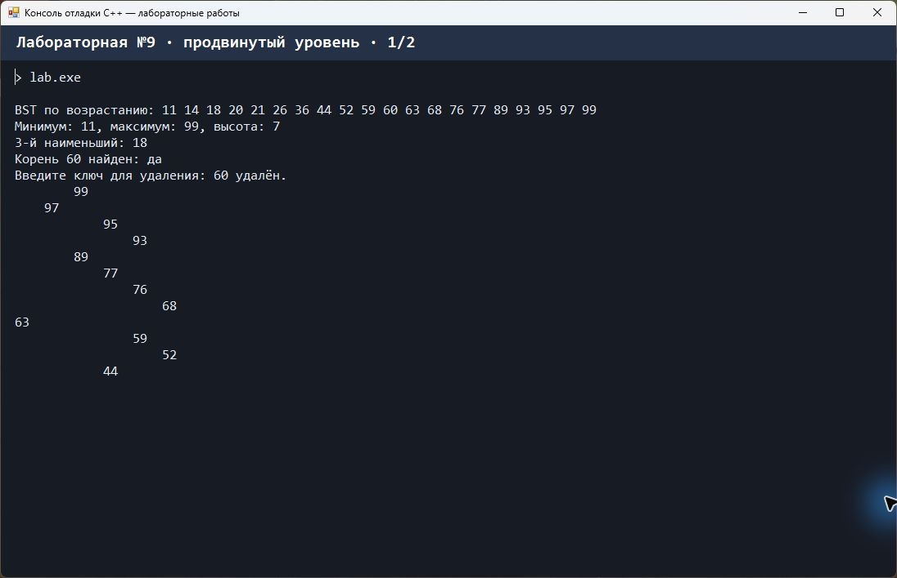
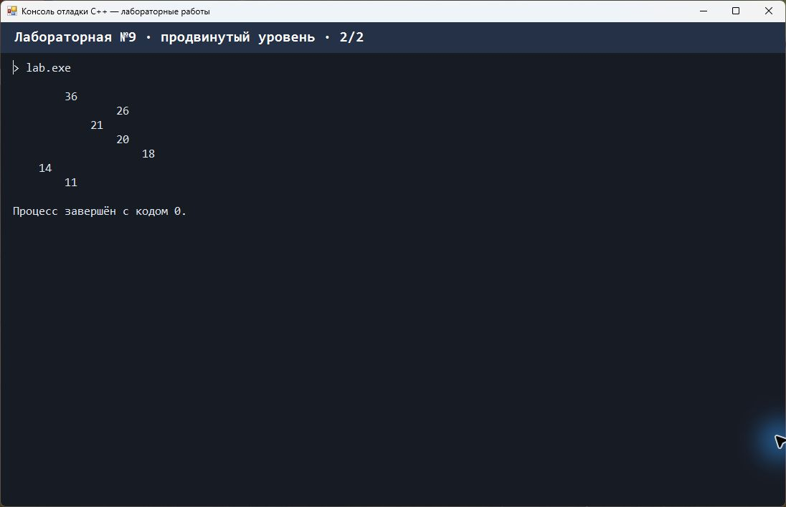

# Лабораторная работа №9 — продвинутый уровень

**Вариант 2**

## Постановка задачи

1. Построить BST из 20 различных случайных чисел. Вывести ключи по возрастанию, минимум, максимум и высоту.
2. Запросить у пользователя ключ, удалить его при наличии и напечатать дерево после операции.

## Сборка и запуск

В Developer PowerShell для Visual Studio

```powershell
cl /nologo /std:c++17 /EHsc /utf-8 /O2 main.cpp SearchTree.cpp /Fe:lab.exe
.\lab.exe
```

С g++

```bash
g++ -std=c++17 -O2 -Wall -Wextra -pedantic main.cpp SearchTree.cpp -o lab
./lab
```

Введите один из напечатанных ключей. На снимке удаляется корень.

## Исходный код

[SearchTree.h](SearchTree.h), [SearchTree.cpp](SearchTree.cpp), [main.cpp](main.cpp)

## Результат работы





## Контрольные вопросы и ответы

**1. Что такое бинарное дерево? Из каких элементов оно состоит?**  
В бинарном дереве есть корень и узлы с не более чем двумя дочерними связями.

**2. В чём отличие бинарного дерева от бинарного дерева поиска (BST)?**  
BST дополнительно требует, чтобы ключи слева были меньше, а справа больше ключа узла.

**3. Какие существуют виды обхода бинарного дерева? В чём их особенности?**  
Прямой обход посещает узел первым, симметричный между поддеревьями, обратный последним. Уровневый идёт сверху вниз.

**4. Какой обход даёт отсортированную последовательность для BST?**  
Симметричный обход BST даёт упорядоченные ключи.

**5. Какова сложность операций поиска, вставки и удаления в BST? От чего она зависит?**  
Поиск, вставка и удаление требуют O(h). Высота зависит от порядка вставки и балансировки.

**6. Что происходит с BST, если вставлять элементы в отсортированном порядке?**  
Без балансировки возрастающий ввод образует цепочку правых потомков.

**7. Какие три случая нужно рассмотреть при удалении узла из BST?**  
Лист удаляют напрямую, узел с одним потомком заменяют потомком, с двумя — минимумом справа либо максимумом слева.

**8. Как найти наименьший элемент в BST? Наибольший?**  
Минимум находится по крайним левым связям, максимум по правым.

**9. Как вычислить высоту бинарного дерева рекурсивно?**  
У пустого дерева высота 0, иначе 1 плюс максимум высот двух поддеревьев.

**10. Что такое наименьший общий предок (LCA) двух узлов в дереве?**  
LCA — самый глубокий узел, лежащий на путях от корня к обоим заданным узлам.

**11. Как проверить, является ли бинарное дерево BST?**  
Для каждого узла проверять допустимый диапазон ключей, уточняя его при спуске влево и вправо.

**12. Что такое сбалансированное дерево? Почему это важно для производительности?**  
Баланс ограничивает высоту. Например, AVL требует разности высот детей не больше единицы для любого узла.

**13. Как преобразовать несбалансированное BST в сбалансированное?**  
Прочитать ключи симметричным обходом и строить дерево рекурсивно, выбирая середину каждого диапазона.

**14. Как восстановить дерево по массиву обхода (in-order + pre-order)?**  
Первый элемент pre-order — корень. В in-order по нему отделяют левое и правое поддеревья и повторяют построение.

**15. Как реализовать итеративный (не рекурсивный) обход бинарного дерева?**  
Можно использовать явный стек для обходов в глубину и очередь для обхода по уровням.

[Общий отчёт лабораторной](../README.md)
